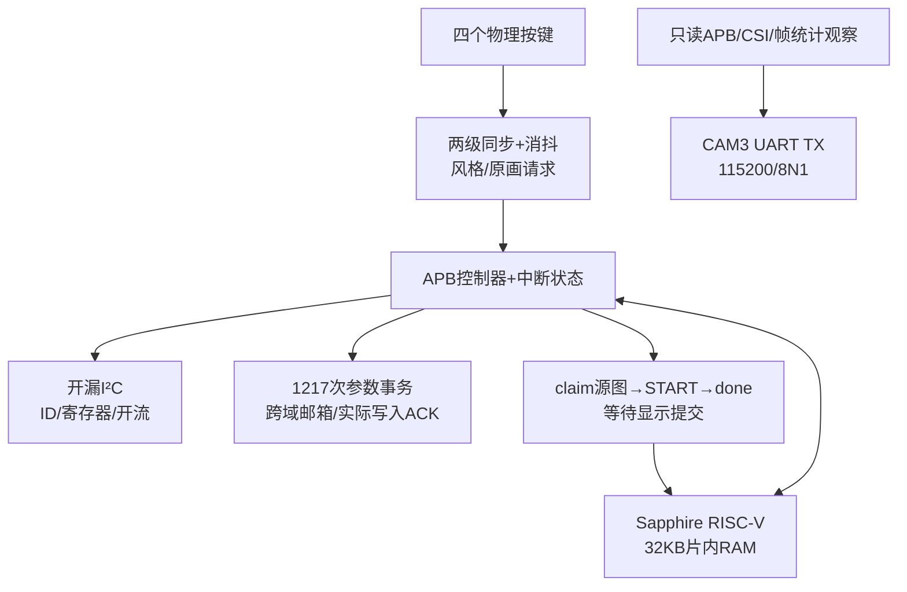

# Ti60 摄像头四风格720p工程：架构、模块接口与实现详解

本文是一份合并后的完整说明，包含框架、逐模块接口、算法与控制、诊断、构建签核，以及完整源声明附录。

阅读导航：[版本与框架](#overview) · [采集/DDR/显示逐模块](#capture-display) · [CNN/跨域/RISC-V逐模块](#cnn-control) · [诊断/构建/使用](#diagnostics) · [完整接口声明](#interfaces)

<a id="overview"></a>

版本日期：2026-10-23。阅读对象：希望从板级连接、RTL、RISC-V软件、DDR到显示逐层理解本工程的队友。

## 1. 本文对应哪一套程序

本文以 **camera_art_styles/build/camera_720_fast** 为唯一当前整机入口。硬件是 **Ti60F225I3 / Ti60F225 DemoBoard V4 + demo10配套SC431HAI模组**。不要用旧VGA版、UART版或demo的接口定义替换本版。

| 项目 | 当前事实 |
|---|---|
| 工程入口（本地） | `build/camera_720_fast/ti60_camera.xml` |
| 顶层模块 | `ti60_camera_ppi_top` |
| 顶层阅读镜像（Git保留） | [ti60_camera_720_top.sv](../rtl/p720/ti60_camera_720_top.sv)，与本次签核build内顶层逐字节一致；源列表仍使用build内原文件，不能再重复加入镜像 |
| FPGA /工具 | Ti60F225，I3时序模型；Efinity2026.1.132 |
| 传感器 | SC431HAI，I²C 7位地址0x30，ID CD6B，1920×1080 RAW10四lane |
| 图像处理 | 真正1280×720；五层12通道定点CNN，四种运行时模型 |
| 风格槽 | 0梵高厚涂，1彩色剪纸，2复古漫画，3水墨 |
| 显示 | 1280×720p60，74.25MHz像素时钟，总1650×750，AVI VIC4 |
| 时钟 | UI/CPU100MHz、CNN166.667MHz、DDR PHY400MHz、MIPI字节域约70MHz约束 |
| 当前bit SHA256 | `fbaecb588dbe01c85db920e8fdeae6a1525f5abd2f459ad913afbf163d10aa19` |
| 实际CAD资源 | RAM10 254/256，DSP148/160，XLR45613/60800 |
| 最终STA | 最小setup +0.428ns、hold +0.026ns；CNN自身setup +0.572ns |
| 当前上板边界 | 原VGA偏置修复版已由用户认可；新720p版完成数字仿真和CAD，尚未实板验证 |

旧版`camera_bias_fix60`处理640×480，再放大960×720。当前从1920×1080全视野得到1280×720，并对全部720p像素执行CNN，最后按原尺寸显示。720p60是显示刷新；不表示摄像头60fps或CNN60fps。

完整720p梵高CNN/DMA验证：921600像素逐值一致，53156739个100MHz UI周期，约0.531567秒/帧、等效1.881fps。该仿真CNN周期6.002ns，约166.611MHz，与最终166.667MHz差0.033%。旧VGA模型2.136fps；新720p像素吞吐约2.64倍，但总FPS略低。四模型完整小尺寸回归通过，完整720p只跑了梵高一模型。这些均不能替代实板FPS，也未满足赛题>15fps。

## 2. 先建立整体框架

### 2.1 图像数据通路

```mermaid
flowchart LR
 S[SC431HAI
1080p RAW10四lane] --> D[D-PHY5.8
公开PPI]
 D --> Q[44位异步PPI FIFO
字节域→100MHz UI]
 Q --> C[CSI解析
ECC/CRC/WC/完整帧]
 C --> B[Bayer插值+2/3取样
1280×720 RGB565]
 B --> P[打包FIFO+采集DMA]
 P --> R[(DDR三个原画bank
4/6/8MB)]
 R --> E[UI侧条带DMA
锁住完整源帧]
 E --> F[24位异步输入FIFO]
 F --> N[CNN166.667MHz
五层卷积/激活]
 N --> G[24位异步输出FIFO]
 G --> O[(DDR双输出bank
0/2MB)]
 O --> V[帧边界提交+读FIFO]
 V --> H[720p60扫描+FPS叠加]
 H --> T[V7 HDMI TX+串化
HDMI屏幕]
```



### 2.2 控制与观测通路



RISC-V负责调度和配置，不执行逐像素卷积。DDR DMA负责像素搬运；FPGA定点卷积负责计算。UART在本摄像头工程中仅输出诊断，不接收图片，不控制风格选择；`uart_rx`保留在板级接口但当前业务未消费。

### 2.3 源码目录如何阅读

```text
camera_art_styles/
  rtl/                         原基础采集、DMA、帧池和控制RTL
    p720/                      最新720p预处理、异步CNN、参数握手、卷积流水
    sot_recovery/              已上板的SoT空闲边界恢复桥
    hdmi60/                    720p60扫描、叠加与原厂TX封装
    view/                      原画切换、RGB统计与CAM3诊断等共用模块
    bias_fix/                  保留的VGA偏置修复基线
  scripts/p720/                最新构建、精确约束、签核和最终复核
  firmware/                    本地C/ASM/链接脚本，不在当前Git白名单内
  vendor/                      本地原厂DDR、D-PHY、HDMI受保护IP与依赖
  build/camera_720_fast/       本地工程XML/peri/SDC、CPU、固件、报告、最终bit
  sim/p720/                    本地RTL/整数/真实IP模型测试与回执
  pc/camera_view.py            CAM3只读串口解析
  docs/                       本文和分阶段验证说明
  architecture.html            可离线阅读架构图
```

Git只保存RTL、Python、PDF、Markdown、architecture.html及requirements.txt等授权范围。build/sim/vendor/权重/生成配置和C/C++继续留本地；仓库不是可单独完整重建的工程归档。本文中的本地工程/固件/报告路径在远程克隆后可能不存在，需要保留原本地工作区和对应工具/IP授权。

在源列表中出现，不代表一定被当前顶层实例化。例如`camera_format_guard`、`csi_status_clear`、`hdmi_encoder`、`tmds_efx`是保留的旧路径模块，当前PPI+V7 HDMI TX通路不通过它们；附录仍列出声明，避免误读目录时混淆。

## 3. 数据格式、地址和握手约定

### 3.1 统一格式表

| 边界 | 格式与位序 | 一拍含义 |
|---|---|---|
| D-PHY→PPI桥 | 4×8位字节、4个valid、4个sync、4个SoT错误；44位原子记录 | 字节域一次接收记录，不等于一个完整像素 |
| CSI桥→Bayer | `raw[39:0]`，4个RAW10，最早像素在`[9:0]` | `valid=1`时4像素；VS标识整帧，HS标识行 |
| Bayer→packer | `pixels[31:0]`，两个RGB565；先来的在`[15:0]` | `pixel_valid=1`时两个有效像素 |
| 捕获FIFO | `{end,bad,frame_id[31:0],index[16:0],pixels[127:0]}`，179位 | 数据记录8像素，或单独EOF记录 |
| DDR | 按行RGB565，小端，无额外stride padding | 128位拍=8像素=16字节，最低16位最早 |
| CNN RGB | `rgb[7:0]=R`，`[15:8]=G`，`[23:16]=B` | 一个RGB888像素，valid/ready传输 |
| HDMI RGB | `rgb[23:16]=R`，`[15:8]=G`，`[7:0]=B` | 一个像素，和DE/HS/VS对齐 |
| CAM3 | 33个32位HEX文本字段，304字节含CRLF | 一份UI域原子快照，不是视频帧 |

注意：CNN内部与HDMI的24位RGB排列不同；DDR RGB565为`{R5,G6,B5}`。必须使用各自的显式展开/重新打包，不能直接把24位总线互连。

720p一行2560字节，一帧1843200字节。每帧115200个128位字，必须使用17位索引；16位最多表示65535，会导致旧式实现回绕。

### 3.2 DDR bank布局和所有权

| bank | 基地址 | 当前用途 |
|---|---|---|
| style0/style1 | `0x00000000` / `0x00200000` | 一个前台供HDMI读取，另一个后台供引擎写入 |
| raw0/raw1/raw2 | `0x00400000` / `0x00600000` / `0x00800000` | 采集、最新完整、推理锁住三个角色动态分配 |

Bank间距`0x00200000`是2MiB，单帧1843200字节可容纳；“MB”标签沿用历史图示，精确地址以十六进制为准。角色不是永久绑定某个raw编号。

- 采集先allocate一个允许写的bank，整帧输入和最后写响应都完成后才publish。
- 引擎claim最新完整原画，锁住其bank和frame_id，整帧处理完成或失败退出后release。
- 处理慢于采集时，采集持续服务，只保留最新完整候选，主动跳过的帧计数。
- 两个风格bank交替；引擎不能写当前HDMI前台。
- CNN的最后一个像素不等于作业完成。还要等输出打包、最后AXI B响应、完整计数和安全消隐提交。
- 错帧、半帧、FIFO溢出、读写错误不得发布给前台；旧完整前台可以继续刷新。

### 3.3 流式valid/ready与AXI规则

CNN只有在`valid && ready`的上升沿才消耗/产生一个像素；被阻塞时保持有效数据，流水相关状态整体停顿。CSI输入没有下游ready，必须靠FIFO与帧作废处理不可服务的突发，不能假装可以让摄像头暂停。

AXI写地址和写数据可独立握手，模块分别记住AW/W已接受状态，收到B后才释放一次写事务。顶层当前写长度AWLEN=0，AWSIZE=4，WSTRB=FFFF，WLAST=1；读长度ARLEN=15，每突发16拍=256字节，ARSIZE=4，INCR，地址256字节对齐，不跨4KiB。端口宽度是30位字节地址，接原厂32位端口时高位补0。

`RRESP!=OKAY`、RLAST拍数不符或`BRESP!=OKAY`需要使当前作业/帧失效；已接受的AXI事务必须先排空，不把错误拍先写入显示FIFO再报告。

## 4. 顶层、时钟、复位和板级接口

### 4.1 顶层不是普通GPIO清单

`ti60_camera_ppi_top`的端口大部分是Interface Designer生成的fabric侧接口：PLL输出、MIPI RX并行字节、LVDS串行器并行字和DDR双沿数据。它们不是让用户把这些信号直接接到排针；物理球位、电压和串化功能由本地`.peri.xml`决定。

参数`PROC_WIDTH=1280`、`PROC_HEIGHT=720`生效；顶层历史保留的`UART_BAUD=2000000`、`UART_PAYLOAD_BYTES=16384`并不控制CAM3，CAM3模块自身默认115200。不要见到顶层旧参数就把串口助手设2Mbps。

| 顶层端口组 | 方向/位宽 | 时钟或物理含义 |
|---|---|---|
| `CLK_25M`, `CLK_27M` | 输入各1 | 板载参考晶振；25MHz用于boot与PLL参考 |
| `core_clk`,`cnn_clk`,`hdmi_tx_slow_clk` | 输入各1 | 100MHz UI、166.667MHz CNN、74.25MHz像素，来自片内PLL |
| `sdram_clk`,`rx_cal_clk`,`tx_cal_clk`,`tx_cal_clk_90edge` | 输入各1 | 原厂DDR PHY/校准时钟，不能随CNN一起改 |
| `pll_locked`,`user_pll_locked`,`core_pll_locked` | 输入各1 | 三PLL锁定，任一失锁触发保护 |
| `style_keys_n[3:0]` | 输入4 | 低有效按键；位0/1/2/3对应四风格槽 |
| `uart_rx`,`uart_tx` | 输入1/输出1 | RX保留未消费；TX为115200诊断 |
| `io_cam_scl_IN`,`io_cam_sda_IN` | 输入各1 | 物理开漏线读回，经过控制器同步再给CPU |
| `io_cam_scl_OUT/OE`,`io_cam_sda_OUT/OE` | 输出各1 | OUT固定0；OE=1拉低、OE=0释放，绝不主动驱动高 |
| `o_cam_rst_p` | 输出1 | 模组RESET高有效；复位或sensor未允许时拉高 |
| `i_cam_ck_LP_P_IN/N_IN`,`i_cam_ck_CLKOUT` | 输入各1 | MIPI时钟lane的LP状态与专用RX输出字节时钟 |
| `o_cam_ck_HS_TERM/HS_ENA` | 输出各1 | D-PHY控制专用RX端接/接收使能，不是向传感器发数据 |
| `cam_d0..d3_HS_IN[7:0]` | 输入4×8 | 四lane的高速RX并行字节 |
| `cam_d0..d3_LP_P_IN/N_IN/FIFO_EMPTY` | 输入4×3 | lane低功耗状态与硬接收FIFO状态 |
| `cam_d0..d3_HS_TERM/HS_ENA/RST/FIFO_RD` | 输出4×4 | RX专用资源控制；RST来自byte域保护复位 |
| `DDR3_PLL_RSTN`,`USER_PLL_RSTN`,`CORE_PLL_RSTN` | 输出各1 | 来自board_boot的低有效PLL复位 |
| `tmds_tx_clk/data0/data1/data2_TX_DATA[9:0]` | 输出4×10 | 一像素对应10位TMDS码字，交给专用串化器 |
| 四路`TX_RST/TX_OE` | 输出4×2 | 像素复位/输出使能；当前OE恒1，失锁时TX_RST断流保护 |
| `pll_shift[2:0]`,`pll_shift_sel[4:0]`,`pll_shift_ena` | 输出3/5/1 | DDR原厂校准动态相位控制 |
| `ddr_ck_hi/lo`,`ddr_reset_n`,`ddr_cke[0]` | 输出各1 | DDR时钟双沿分量/复位/时钟使能 |
| `ddr_addr[13:0]`,`ddr_ba[2:0]`,`ddr_cs_n[0]`,`ddr_ras_n/cas_n/we_n`,`ddr_odt[0]` | 输出14/3/1/3×1/1 | DDR命令/地址，由原厂PHY生成 |
| `ddr_dqs_in_hi/lo[1:0]`,`ddr_dq_in_hi/lo[15:0]` | 输入2×2/2×16 | 专用DDR IO捕获后的双沿数据 |
| `ddr_dqs_oe/oe_n[1:0]`,`ddr_dq_oe[15:0]` | 输出2/2/16 | 原厂PHY控制双向数据口的OE |
| `ddr_dqs_out_hi/lo[1:0]`,`ddr_dq_out_hi/lo[15:0]`,`ddr_dm_hi/lo[1:0]` | 输出2×2/2×16/2×2 | DDR专用输出双沿数据和掩码 |

所有拼写及表达式原文见后面的“源文件接口声明附录”，包括顶层完整端口，不能只按本表缩写生成约束。

### 4.2 board_boot与reset_sync

`board_boot(clk,keys_n[3:0],reset_n)`运行于25MHz。默认POWER_CYCLES=2500000，即约100ms启动等待；HOLD_CYCLES=25000000，即KEY0+KEY3持续约1秒触发逻辑复位。按键先meta/sync两级同步。boot时钟不跟随PLL停振，因此可以在PLL复位期间继续计数。

`reset_sync(clk,async_reset,reset)`使用三级FF，异步置复位、目标域同步释放。顶层关系为：

```text
ddr_reset  = sync_ui(!sys_rst_n || !DDR_PLL_LOCK || !CORE_PLL_LOCK || !USER_PLL_LOCK)
reset_ui   = sync_ui(ddr_reset || !calibrated)
reset_pixel= sync_pixel(!sys_rst_n || !DDR_PLL_LOCK || !CORE_PLL_LOCK || !USER_PLL_LOCK)
reset_byte = sync_byte(reset_ui)
system.reset = reset_ui || soc_reset
sensor_reset = reset_ui || !sensor_reset_n
```

像素复位故意不等DDR校准，因此能先显示启动彩条和初始化故障；CPU、MIPI/采集等仍等校准。校准失效不要求HDMI停止扫描，但数据前台重新失效。任一PLL失锁时DDR/UI/像素保护共同生效。

CNN额外有fast_domain全局复位同步器、strip_domain每条复位同步器。实际综合把strip_domain的三级与输入FIFO的前三个同构复位FF合并，最终复核检查了真实三级链和内核复位连接，不能只看名字是否还叫strip_domain。每条复位会冲掉条带流数据和计算状态，权重写入逻辑不由此清空；全局复位取消在途事务并重新启动初始化。

### 4.3 video_system_720如何接起子模块

这是100MHz UI控制与像素域显示的汇合点。它把APB控制、按键、预处理、采集FIFO、三源帧池、写仲裁、作业控制、异步CNN、读仲裁、帧读取、像素FIFO、扫描、FPS叠加连接起来，本身不实例化厂商DDR PHY或CPU。

其外部接口分为：APB16位地址/32位数据、摄像头VS/HS/valid/RAW40/error、AXI30位地址/128位数据、像素RGB24/HS/VS/DE、按键/I²C控制，以及四个32位累计诊断/4位状态/288位图像统计。端口均在附录给出原始声明。`fast_clk`只进入CNN子系统；UI的帧池、仲裁、CPU和DDR端口没有被整体加速。

`input_stats`统计最近一份有效预处理图；`output_stats`统计最近一次成功引擎作业。`neural_frames`只在`engine_done && !engine_raw`增加，原画复制不增加I。`front_raw`仅在显示提交完成时更新，与请求raw_mode、引擎锁存engine_raw区分。

### 4.4 三个原厂IP公开边界

| IP | 当前连接方式 | 本工程负责什么、不证明什么 |
|---|---|---|
| `camera_dphy inst_camera_dphy`（5.8） | reset_n/UI100MHz，reset_byte_HS_n/字节时钟，四lane专用RX输入，输出RxDataHS/Valid/Sync/SoT/Control/Escape | 使用公开PPI，不实例化曾有元数据CDC争议的CSI5.15 byte2pixel；不修改或解密D-PHY；物理眼图/温升仍需实测 |
| `control_soc cpu`（Sapphire3.4.0） | systemClk=UI，asyncReset=reset_ui；APB主口接system.control；userInterruptA接IRQ16；JTAG调试口关闭 | 32KB片内RAM跑实际固件；CPU不走DDR主口搬图；AXI图像DMA是单独硬件 |
| `ddr3_top u_ddr3_top`（V7原厂） | core/AXI均UI100MHz，PHY400MHz；AXI128/地址补高0，cal_done驱动calibrated | 保留原DDR参数和校准动态相位；本工程管理请求与帧所有权，不重写受保护PHY |

原厂HDMI的`dvi_encoder`通过tmds_hdmi60公开端口使用，其名称不表示当前只是无AVI的旧DVI式发射：这里传VIC4/RGB，音频有效拉0。受保护实现及辅助包模块按V7依赖保留，不能仅复制外层封装就假定可独立综合。

## 5. 带你跟踪一帧和一次风格切换

1. boot等待结束并释放三个PLL；锁定稳定后各域复位依次释放。像素域可先彩条。
2. DDR校准完成，CPU从片内RAM运行，释放配套模组复位，通过开漏I²C检查ID、配置模式并读回尺寸/VTS/曝光边界。
3. CPU把目标模型1217个32位数据字按规定地址序列写APB。跨域邮箱逐笔收到实际内核写入确认后放行下一笔/最终提交，再开流。
4. MIPI数据在字节域被D-PHY还原为PPI，原子FIFO带数据和错误状态到UI；桥验证CSI包/行/帧并输出四像素RAW10。
5. Bayer把完整视野插值和取样成720p，packer打128位数据，writer写入分配到的raw bank。EOF和最后B都满足才使latest有效，C累计一次。
6. CPU在允许条件下START；jobs claim一个完整源帧，锁住frame_id/bank，选后台输出bank。即使摄像头又采了新帧，引擎仍只读锁住的同一张源图。
7. engine依次处理27条。UI用缓存和16拍突发取源图；像素跨异步FIFO给166.667MHz CNN；五层结果跨回UI，只把中央有效列写后台bank，丢弃halo和最后多出的列。
8. 全部输出计数、最后写响应和引擎done成立后，jobs请求显示commit。reader只能在同步后的安全消隐窗口切前台，错过就等下一帧；不在有效显示中途撕裂。
9. 作业完成/失败/按键通过IRQ状态通知CPU，固件W1C清中断。按键忙时只保留最新请求；目标改变时等待当前事务安全结束，再加载新权重，不在半帧中混用模型。
10. 显示不断从完整前台读图；没新推理也继续60Hz刷新。诊断每秒报告完整采集数、CNN完成数、错误和统计，帮助区分显示卡住与推理变慢。


---


<a id="capture-display"></a>
## 最新 Ti60 摄像头工程：采集、DDR 与显示模块逐项解读

本文对应 2026-10-23 的 `camera_720_fast`，可作为主工程详细解读中的数据通路分册。以实际工程源文件清单、模块声明和连接为依据；旧版 `camera_ppi`、`camera_view60`、`camera_bias_fix60` 不能直接代替本版。

- 工程入口：[ti60_camera.xml](../build/camera_720_fast/ti60_camera.xml)。
- 顶层：[ti60_camera_ppi_top.sv](../build/camera_720_fast/rtl/ti60_camera_ppi_top.sv)。
- 子系统：[video_system_720.sv](../rtl/p720/video_system_720.sv)。
- 验证与性能边界：[full720.md](full720.md)。

这里的“输入/输出”均相对本节模块；`[N:0]` 表示 N+1 位，表中未注明位宽的控制端口均为 1 位。`clk` 默认指该模块端口的上升沿，`reset` 默认高有效；跨域模块另外说明。正常 AXI 通道在 `VALID && READY` 的时钟沿发生传输，VALID 一旦发出，发方必须在握手前保持数据和控制不变。

### 1. 先把完整链路看清楚

```mermaid
flowchart LR
  CAM[SC431HAI 模组\n1920×1080 RAW10 四 lane] --> DPHY[原厂 D-PHY RX 5.8\n公开 PPI 接口]
  DPHY --> CDC[512×44 原子异步 FIFO\nbyte_clk → UI 100MHz]
  CDC --> CSI[CSI 包解析\nECC / WC / CRC / FS / FE]
  CSI --> BAYER[Bayer 双线性 3×3\n全视野 2/3 选点]
  BAYER --> RGB[1280×720 RGB565\n每拍两个像素]
  RGB --> PACK[8 像素打包\n数据记录与 EOF 记录]
  PACK --> CAPFIFO[512×179 采集 FIFO]
  CAPFIFO --> WRITER[逐个 128bit 单拍写\n等待每笔 B 响应]
  WRITER --> RAWDDR[DDR 三个原画 bank\n4 / 6 / 8 MiB]
  RAWDDR --> CNN[条带 DMA + CNN\nUI100 / CNN166.667MHz]
  CNN --> STYLEDDR[DDR 两个输出 bank\n0 / 2 MiB]
  STYLEDDR --> READER[16 拍突发显示读\n消隐换前台]
  READER --> PIXFIFO[512×128 → 4096×16\n异步像素 FIFO]
  PIXFIFO --> RASTER[74.25MHz 扫描\n1280×720p60]
  RASTER --> FPS[C / I / H60 叠加]
  FPS --> HDMI[V7 HDMI TX\nAVI VIC4 + TMDS]
```



图中原画模式也经条带引擎复制到输出 bank，显示器始终读取输出 bank。原画模式关闭 CNN 运算，但不是让 HDMI 随意读取正在采集的原画 bank。

#### 1.1 三个关键尺寸与四种时钟

| 项目 | 本版数值 | 含义 |
| --- | --- | --- |
| 传感器有效图像 | 1920×1080、RAW10、4 lane | 每像素 10 位 Bayer，不能直接作为 RGB 显示 |
| Bayer 后处理帧 | 1280×720、RGB565 | 全视野采样得到的真实 CNN 输入，不是旧 VGA 放大 |
| CNN 输出及 HDMI 有效区 | 1280×720 | 不再保留旧版 960×720 放大区域 |
| `byte_clk` | D-PHY 接收字节时钟，配置按 70MHz | 来自摄像头 HS 时钟；LP 期间允许停振，不能当成始终连续的系统时钟 |
| `core_clk` / `ui_clk` / 大部分 `clk` | 100MHz | CSI 解析、预处理、DDR 应用接口、DMA、CPU、统计控制 |
| `cnn_clk` / `fast_clk` | 166.667MHz | 只提高 CNN 运算域，不提高 DDR UI 频率 |
| `pixel_clk` | 74.25MHz | HDMI 扫描和像素 FIFO 读端 |
| DDR PHY 相关时钟 | 400MHz 及其校准相位 | 由独立 DDR PLL 与原厂控制器管理，不等于应用层每拍都能传 128 位 |

#### 1.2 像素顺序、地址与记录格式

RGB565 定义为 `{R[7:3],G[7:2],B[7:3]}`。一行从左到右，行从上到下；同一 128 位字中，**最早像素放在最低 16 位**。相邻像素在 DDR 中相距 2 字节，相邻行相距 2560 字节，无额外行 padding。

```text
128bit 字： [127:112] P7 ... [31:16] P1 [15:0] P0
32bit 双像素： [31:16] 后一个像素 [15:0] 前一个像素
一帧大小：1280 × 720 × 2 = 1,843,200 字节 = 0x1C2000
128bit 字数：1,843,200 / 16 = 115,200 = 0x1C200
行字数：1280 / 8 = 160
```

| 用途 | bank 编号 | DDR 字节基址 | 当前一帧结束后的首地址 | 为什么间隔 2MiB |
| --- | --- | --- | --- | --- |
| 风格/原画复制输出 | 0 | `0x00000000` | `0x001C2000` | 使帧地址清晰且容纳完整 720p RGB565 |
| 风格/原画复制输出 | 1 | `0x00200000` | `0x003C2000` | 不能覆盖显示正在读取的前台 |
| 摄像头原画 | 0 | `0x00400000` | `0x005C2000` | 采集、最新完整、CNN 锁定帧可同时存在 |
| 摄像头原画 | 1 | `0x00600000` | `0x007C2000` | 同上 |
| 摄像头原画 | 2 | `0x00800000` | `0x009C2000` | 同上 |

采集 FIFO 不是只有像素，其 179 位记录布局为：

| 位范围 | 字段 | 说明 |
| --- | --- | --- |
| `[178]` | `end_record` | 0=像素数据记录，1=帧尾记录 EOF |
| `[177]` | `bad` | 上游发现本帧不可靠，不能发布 |
| `[176:145]` | `frame_id[31:0]` | 同帧记录必须一致 |
| `[144:128]` | `word_index[16:0]` | 数据记录 0…115199；EOF 应为 115200 |
| `[127:0]` | `pixels` | 数据记录的 8 个 RGB565 像素；EOF 固定为零 |

索引从旧版 16 位扩成 17 位非常必要：115200 大于 65535。仅扩大图像常量而保留旧索引，会在帧中间回绕。

### 2. `camera_dphy`：把 MIPI 电气接收变成公开 PPI 字节流

文件：[vendor/camera_dphy.sv](../vendor/camera_dphy.sv)。实例：顶层 `inst_camera_dphy`。这是 IP Manager 生成的原厂 D-PHY RX 5.8 封装，内部受保护实现不作反推或修改。

当前公开配置：`NUM_DATA_LANE=4`、`HS_BYTECLK_MHZ=70`、`CLOCK_FREQ_MHZ=100`、`DPHY_CLOCK_MODE="Discontinuous"`、`ENABLE_USER_DESKEWCAL=0`。HS settle 等时序采用封装中原有参数：`tLPX_NS=50`、`tCLK_TERM_EN_NS=38`、`tD_TERM_EN_NS=35`、`tHS_SETTLE_NS=85`、`tHS_PREPARE_ZERO_NS=145`。

| 端口 | 方向/宽度 | 时钟或对象 | 定义与本版连接 |
| --- | --- | --- | --- |
| `clk` | 输入 1 | UI 100MHz | D-PHY 控制时钟，顶层接 `core_clk` |
| `reset_n` | 输入 1 | 控制域，低有效 | 顶层 `!reset_ui` |
| `clk_byte_HS` | 输入 1 | 接收字节域 | 顶层 `i_cam_ck_CLKOUT` |
| `reset_byte_HS_n` | 输入 1 | 字节域，低有效 | 顶层 `!reset_byte`；字节域复位同步释放 |
| `Rx_LP_CLK_P`, `Rx_LP_CLK_N` | 各输入 1 | MIPI 时钟 lane 低功耗状态 | 接专用接收接口 LP 检测输出 |
| `Rx_HS_enable_C`, `LVDS_termen_C` | 各输出 1 | MIPI 时钟 lane 接收控制 | 接时钟 lane 的 HS 使能与终端控制 |
| `RxUlpsClkNot`, `RxUlpsActiveClkNot` | 各输出 1 | 时钟 lane 状态 | 本顶层悬空，仅作 IP 状态输出 |
| `Rx_LP_D_P`, `Rx_LP_D_N` | 各输入 4 | 四个数据 lane 的 LP 状态 | bit0…3 对应 lane0…3 |
| `Rx_HS_D_0`, `Rx_HS_D_1`, `Rx_HS_D_2`, `Rx_HS_D_3` | 各输入 8 | 字节域 | 专用接收接口输出的四 lane 并行字节 |
| `Rx_HS_D_4`, `Rx_HS_D_5`, `Rx_HS_D_6`, `Rx_HS_D_7` | 各输入 8 | 未启用 lane | 当前各接 `8'd0` |
| `Rx_HS_enable_D`, `LVDS_termen_D` | 各输出 4 | 四个数据 lane 接收控制 | 接各 lane HS 使能与终端控制 |
| `fifo_rd_enable` | 输出 4 | 四 lane 接收 FIFO | 接各 `cam_dN_FIFO_RD` |
| `fifo_rd_empty` | 输入 4 | 四 lane 接收 FIFO | 来自各 `cam_dN_FIFO_EMPTY` |
| `DLY_enable_D`, `DLY_inc_D` | 各输出 4 | 接口延迟控制 | 本顶层未使用输出 |
| `u_dly_enable_D`, `u_dly_inc_D` | 各输入 4 | 用户延迟控制 | 当前均接零，不在运行时调整 |
| `RxDataHS_0`, `RxDataHS_1`, `RxDataHS_2`, `RxDataHS_3` | 各输出 8 | PPI 字节域 | 组成 `ppi_data[31:0]`，lane0 在最低字节 |
| `RxDataHS_4`, `RxDataHS_5`, `RxDataHS_6`, `RxDataHS_7` | 各输出 8 | 未启用 lane | 本顶层悬空 |
| `RxValidHS` | 输出 4 | PPI 字节域 | 每 lane 字节有效，接 `ppi_valid` |
| `RxSyncHS` | 输出 4 | PPI 字节域 | 每 lane 新 HS/SoT 同步事件，接 `ppi_sync` |
| `RxErrSotSyncHS` | 输出 4 | PPI 字节域 | 每 lane SoT 状态，接 `ppi_sot_error` |
| `RxErrControl`, `RxErrEsc` | 各输出 4 | D-PHY 错误状态 | 顶层分别归约或后送入桥的 `control_error` |
| `RxActiveHS`, `RxSkewCalHS`, `RxStopState` | 各输出 4 | HS/校准/停止状态 | 顶层未连接到功能控制 |
| `RxUlpsEsc`, `RxUlpsActiveNot`, `RxLPDTEsc`, `RxValidEsc` | 各输出 4 | LP/ULPS/escape 状态 | 顶层悬空 |
| `RxDataEsc_0`, `RxDataEsc_1`, `RxDataEsc_2`, `RxDataEsc_3`, `RxDataEsc_4`, `RxDataEsc_5`, `RxDataEsc_6`, `RxDataEsc_7` | 各输出 8 | escape 数据 | 当前不使用 LP 数据业务，均悬空 |

PPI 还不是 CSI 图像：它只提供字节、lane 有效位和同步/错误信息。包类型、帧边界、RAW10 解包由下面的公共 RTL 实现。当前路径没有使用曾出现内部元数据跨域争议的 CSI 5.15 `byte2pixel`。

### 3. `csi_ppi_bridge_recover`：跨域、lane 对齐、CSI 验包和 RAW10 解包

文件：[csi_ppi_bridge_recover.sv](../rtl/sot_recovery/csi_ppi_bridge_recover.sv)。实例：顶层 `bridge`。

参数：`RAW_WIDTH=1920`、`RAW_HEIGHT=1080`、`FRAME_TIMEOUT=5000000`。默认每行 RAW payload 为 `LINE_BYTES=RAW_WIDTH*10/8=2400` 字节；UI 为 100MHz 时帧内 watchdog 上限约 50ms。当前实现前提为 VC0、四 lane、宽度满足 RAW10 分组及 32 位读取对齐要求、一个 CSI 包对应一次 HS 传输；不是任意 CSI-2 接收器。

#### 3.1 全部外部端口

| 端口 | 方向/宽度 | 时钟 | 定义 |
| --- | --- | --- | --- |
| `byte_clk`, `byte_reset` | 各输入 1 | 字节域 | PPI 写入时钟、对应高有效复位 |
| `ui_clk`, `ui_reset` | 各输入 1 | UI 域 | 包解析时钟、全桥高有效复位 |
| `ppi_data` | 输入 32 | 字节域 | lane0…3 四个字节，lane0 位 `[7:0]` |
| `ppi_valid`, `ppi_sync`, `ppi_sot_error` | 各输入 4 | 字节域 | 每 lane 字节有效、同步事件、SoT 错误位；与数据合并原子跨域 |
| `control_error` | 输入 1 | UI 解析控制输入 | 顶层由 D-PHY control/escape 错误归约，异常时本帧作废 |
| `vs` | 输出 1 | UI 域 | 帧内有效电平；**上升沿帧开始，下降沿帧结束** |
| `hs` | 输出 1 | UI 域 | RAW 长包 payload 所在行有效区，不是 HDMI 行同步 |
| `valid` | 输出 1 | UI 域 | 本拍 `raw` 中四个 RAW10 像素有效；无 READY，接收方必须承受输入 |
| `raw` | 输出 40 | UI 域 | `[9:0]` 最早像素，随后 `[19:10]`、`[29:20]`、`[39:30]` |
| `packet_error` | 输出 1 | UI 域 | 本帧 `bad` 或运输层故障，必须传播到帧尾作废判断 |
| `transport_fault` | 输出 1 | UI 域 | PPI 异步 FIFO 溢出锁存，需全局复位恢复 |
| `good_lines` | 输出 32 | UI 域 | CRC 与残字节检查通过的 RAW 行累计数，跨帧累计 |
| `error_packets` | 输出 32 | UI 域 | 解析所选错误分支/超时累计，不保证每个坏帧恰好加一 |
| `debug_events` | 输出 32 | UI 域 | 异步 FIFO 被读取的 PPI 事件记录数 |
| `debug_header` | 输出 32 | UI 域 | 最近一次满足解析条件的包头快照，不代表全部图像正确 |
| `trace_fields` | 输出 384 | UI 域 | 12 个 32 位细分诊断字段，见下表 |
| `soft_sot_records` | 输出 32 | UI 域 | 满足严格空闲条件而容忍的孤立 SoT 状态记录数 |

#### 3.2 关键实现步骤

1. 当任一 lane 有 valid、sync 或 SoT 状态时，构成 `{sot_error[3:0],sync[3:0],valid[3:0],data[31:0]}`，写入 512×44 异步 FIFO。状态和数据一起传，避免分别同步后对错字节。
2. UI 域读取事件，四个 lane 各自有 16 字节的寄存器队列。每 lane 收到同步才 `armed`；允许不同 lane 的同步事件相差若干记录，累计 `sync_seen` 后再开始包头。
3. 状态机依次为 `WAIT_SOT → HEADER → PAYLOAD → CRC → WAIT_SOT`。短包 FS/FE/LS/LE 在 HEADER 直接处理；长包进入 PAYLOAD。
4. `HEADER` 检查 ECC、高保留位、VC。即使是可纠正的单 bit 包头错误，当前策略也是拒收，不做 ECC 修复。支持 DT `0x00` FS、`0x01` FE、`0x02/0x03` 可选行短包、`0x2B` RAW10；其它类型判错。
5. RAW10 长包必须在帧内，WC 必须为 2400，已完成行数不能超 1080。每收四字节更新 CRC16，累积够五字节后拆成四个 10 位样本。
6. RAW10 五字节中，前四字节是四像素高八位，第五字节依次提供四像素低二位。四样本按光栅顺序放进 `raw[39:0]`。
7. `CRC` 检查 CRC16 和 RAW 残字节数，正确才增加 `line_count/good_lines`。收到 FE 时，必须已经累计 1080 好行，才是完整帧。
8. 一个帧尚未结束又收到 FS，会先结束旧坏帧，再用 `fs_pending` 开启新帧；不会把两个源帧拼接为一帧。

帧错误 `bad` 在新 FS 开始时清零，运输层溢出 `transport_fault` 则保持到全局复位。包被新 SoT 中断、lane 队列溢出、错误格式/尺寸/CRC、错误 FE、超时均使当前帧失效；下游可能已经接到这帧部分像素，因此下游还必须等 EOF 才发布。

#### 3.3 “SoT 恢复”到底允许了什么

只有满足以下所有条件的 `in_error` 才是 `soft_sot_error`：解析器在 `WAIT_SOT`，`sync_seen==0`，四 lane 队列全空，本记录没有 valid，也没有 sync。这类记录计数后允许继续等下一个包；其它 SoT 错误仍为硬错误。它没有跳过包头 ECC、payload CRC、帧行数和最终 EOF 检查，也没有因为一条 soft 记录就发布一帧。

#### 3.4 `trace_fields` 按从高位到低位展开

| 位范围 | 字段 | 说明 |
| --- | --- | --- |
| `[383:352]` | `trace_control_cycles` | control/escape 错误输入为高的 UI 周期数 |
| `[351:320]` | `trace_control_rises` | 上述输入上升次数 |
| `[319:288]` | `trace_sot_records` | 所有 SoT 错误记录数，含可容忍记录 |
| `[287:256]` | `trace_lane_overflows` | lane 内部 16 字节队列溢出事件 |
| `[255:224]` | `trace_header_errors` | 包头 ECC/保留位/VC 错误 |
| `[223:192]` | `trace_format_errors` | RAW WC/帧位置或不支持 DT |
| `[191:160]` | `trace_crc_errors` | CRC 或 RAW 残字节检查失败 |
| `[159:128]` | `trace_packet_interrupts` | 包尚未完成就出现新同步 |
| `[127:96]` | `trace_fe_errors` | FE 时帧/行计数不合法 |
| `[95:64]` | `trace_timeout_errors` | 帧超时 |
| `[63:32]` | `trace_fs_overlaps` | 旧 VS 尚高时出现新 FS |
| `[31:0]` | `trace_first_error_context` | 本次 bad 从 0→1 时记录 `{reason[3:0],state[1:0],vs,hs,line_count[15:0],raw_bytes[3:0],sync_seen[3:0]}` |

上下文字段 reason：1 control、2 硬 SoT、3 lane 溢出、4 PPI 溢出、5 包头、6 格式、7 CRC、8 中断、9 FE、10 超时、11 重复部分 SoT、12 重叠 FS。计数器主要用于定位，不参与图像使能或错误放行。

### 4. `camera_bayer_720`：真实 720p 预处理

文件：[camera_bayer_720.sv](../rtl/p720/camera_bayer_720.sv)。实例：`system.reduce`。

参数：`RAW_WIDTH=1920`、`RAW_HEIGHT=1080`、`WIDTH=RAW_WIDTH*2/3=1280`、`HEIGHT=RAW_HEIGHT*2/3=720`、`FIFO_DEPTH=512`。当前实现是精确的 2/3 选点结构；仅修改 WIDTH/HEIGHT 不会变成任意比例缩放器。

| 端口 | 方向/宽度 | 时钟 | 定义 |
| --- | --- | --- | --- |
| `clk`, `reset` | 各输入 1 | UI | 高有效复位 |
| `vs`, `hs`, `valid` | 各输入 1 | UI | 来自桥的帧电平、行电平、四 RAW 样本有效 |
| `raw` | 输入 40 | UI | 四个相邻 RAW10，低位最早 |
| `pattern` | 输入 2 | UI，在帧开始锁存 | 0 BGGR、1 RGGB、2 GBRG、3 GRBG；当前接 0 |
| `packet_error` | 输入 1 | UI | 本帧 CSI/运输层错误，最终置坏帧 |
| `pixels` | 输出 32 | UI | 两个 RGB565，低 16 位先输出 |
| `pixel_valid` | 输出 1 | UI | 两个像素均有效，单拍脉冲，无 READY |
| `frame_start`, `frame_end` | 各输出 1 | UI | 单拍帧开始、冲刷流水后的帧结束 |
| `frame_bad` | 输出 1 | UI | 随 `frame_end` 判断本帧是否可发布 |
| `overflow` | 输出 1 | UI | RAW 事件队列溢出锁存；当前系统未单独引出，但会使 `frame_bad` 置位 |

#### 4.1 事件队列与计算节拍

PPI 桥可能一拍交付四个 RAW，而 Bayer 内核一拍处理两个 RAW。模块将 `{vs,hs,valid,error,raw}` 合并为 44 位同步事件记录；valid、VS/HS 边沿或错误状态变化都会进队列。FIFO 保存边沿与样本的相对顺序，防止“像素还没处理完，外部 VS 已经结束”的错配。

内部 `WAIT_RECORD` 取一个事件，先处理低两个 RAW，并保存高两个；`SECOND_PAIR` 在下一拍处理高两个；帧结束进入 `FINISH` 冲刷窗口/选点/双像素打包流水，再产生 frame_end。输入没有反压能力，FIFO 满必须作废，不能静默丢像素后发布。

#### 4.2 Bayer 与缩小不是同一件事

先由两条 16 位行存储及左右历史样本形成完整 RAW 3×3 邻域，对每个选中位置做 Bayer 双线性插值：

- 红/蓝点：中心保留自身色，四个正交邻居均值得绿，四个对角邻居均值得另一色。
- 绿点：中心保留绿，沿相应水平方向和垂直方向分别补红、蓝。
- 二点均值用 `(a+b+1)>>1`，四点均值用 `(a+b+c+d+2)>>2`，是有明确舍入的整数运算。
- RAW10 先取高八位，再形成 RGB565，当前没有白平衡、黑电平自动校正、去噪、自动 Gamma 或自动曝光环路。

输出坐标 `(u,v)` 对应的 RAW 中心为：`x=floor(3*u/2)`、`y=floor(3*v/2)`。取点序列 0、1、3、4、6、7……，因此覆盖整个传感器视野。末端取到 x=1918、y=1078，其右/下邻居 1919/1079 实际存在；上/左边缘采用 reflect-101 构造邻居，不必凭空补最后一整行。

模块核对每行 RAW 数、每帧 RAW 行数、输出总像素数、两像素打包是否还有 pending 残项。只要任一不符，最终 `frame_bad=1`。一个正确输出帧应恰好产生 460800 个 `pixel_valid` 拍，对应 921600 像素。

### 5. `video_rgb_stats`：只观察，不修颜色

文件：[video_rgb_stats.sv](../rtl/view/video_rgb_stats.sv)。实例：`system.input_stats`。参数 WIDTH/HEIGHT 实际为 1280/720，声明默认 640/480。

| 端口 | 方向/宽度 | 时钟 | 定义 |
| --- | --- | --- | --- |
| `clk`, `reset` | 各输入 1 | UI | 统计状态时钟与复位 |
| `frame_start`, `frame_end`, `frame_bad` | 各输入 1 | UI | 开始清累加器，结束判完整/坏帧 |
| `pixel_valid` | 输入 1 | UI | 本拍输入两个 RGB565 |
| `pixels` | 输入 32 | UI | 按前述低位优先顺序 |
| `stats` | 输出 128 | UI | 最近完整好帧的 `{像素数[31:0],sumR[31:0],sumG[31:0],sumB[31:0]}` |

RGB565 展开到 RGB888 采用位复制：R/B `5bit→8bit`，G `6bit→8bit`。只有帧尾无错且计数恰等于 WIDTH×HEIGHT 才更新 stats；坏帧保留上一个好帧结果。均值由主机以 `sum/count` 计算。这个模块没有向传感器或模型反馈，不能把它称为白平衡模块。

### 6. `camera_pack_720` 与采集 FIFO：像素必须带上“帧身份”

文件：[camera_pack_720.sv](../rtl/p720/camera_pack_720.sv)。实例：`system.packer`。参数声明默认 WIDTH=640、HEIGHT=480；系统显式传入 1280/720。

| 端口 | 方向/宽度 | 时钟 | 定义 |
| --- | --- | --- | --- |
| `clk`, `reset` | 各输入 1 | UI | 打包状态时钟与复位 |
| `enable` | 输入 1 | UI | 只在 frame_start 决定是否收本帧；中途改变不把半帧变成新帧 |
| `frame_start`, `frame_end`, `frame_bad` | 各输入 1 | UI | 上游帧开始、结束与最终错误 |
| `pixel_valid` | 输入 1 | UI | 本拍两个像素有效 |
| `pixels` | 输入 32 | UI | 每拍两个 RGB565 |
| `fifo_full` | 输入 1 | UI | 采集 FIFO 满；上游不能暂停，故必须记坏帧 |
| `fifo_write` | 输出 1 | UI | 对 179 位 FIFO 的单拍写使能 |
| `fifo_data` | 输出 179 | UI | 记录布局见 1.2 节 |
| `overflow_frames` | 输出 32 | UI | 此打包器发现的溢出帧计数；不是所有故障的总和 |

每四个双像素拍形成一个 128 位字。frame_start 时帧号加一、索引清零、锁存 enable。输出四组双像素后产生一条数据记录，word_index 加一。frame_end 必须再产生**独立 EOF 记录**；其 bad 合并内部溢出、上游 frame_bad、最终字数错误和非零 lane 余数。

重要区别：数据记录上的 bad 可能尚未反映帧最后才发现的 CSI CRC/FE 问题；所以收完第 115199 号数据字不能自行认定成功，必须再验证 EOF。若 EOF 自身也因 FIFO 满而丢失，后续新帧的 index0 会触发 writer 终止旧帧，不会把旧帧发布。

`system.capture_fifo` 使用 `efx_fifo_wrapper`：TITANIUM、同步 UI、FWFT、DEPTH512、DATA_WIDTH179、PIPELINE_REG1、OUTPUT_REG0，存 512 条**带元数据的记录**。它的时钟没有跨域。采集延迟队列与 DDR 帧缓存是两种不同存储，不能把 512 条记录称为完整帧缓存。

此实例的有效公开连接：`a_rst_i=reset`；独立写/读复位接 0；`clk_i=clk`，异步 wr/rd 时钟端接 0；`wr_en_i=capture_fifo_write`、`rd_en_i=capture_fifo_read`、`wdata/rdata` 为179位，`full_o/empty_o` 反馈打包器/writer。almost/prog/full/empty、overflow/underflow、ack、数据计数、rd_valid、rst_busy 端口在此实例未使用；不能依赖未接输出进行系统保护。

### 7. `camera_frame_writer_720`：完整帧发布的第一道屏障

文件：[camera_frame_writer_720.sv](../rtl/p720/camera_frame_writer_720.sv)。实例：`system.writer`。

参数：WIDTH/HEIGHT 系统传入1280/720；`SOURCE_BASE=0x00400000`、`BANK_STRIDE=0x00200000`。每条记录对应单拍 128 位 AXI 写，16 字节对齐；此模块没有 AXI burst 长度端口，顶层固定 AWLEN=0、AWSIZE=4、WLAST=1、WSTRB=0xFFFF。

| 端口 | 方向/宽度 | 时钟 | 定义 |
| --- | --- | --- | --- |
| `clk`, `reset` | 各输入 1 | UI | 写状态机时钟、复位 |
| `fifo_data` | 输入 179 | UI | 当前 FWFT 记录 |
| `fifo_empty` | 输入 1 | UI | 无记录时不能读 |
| `fifo_read` | 输出 1 | UI | 当前记录被消费；只在 IDLE 且非待分配新帧时拉高 |
| `allocate` | 输出 1 | UI | 向原画池请求一个未占用 bank，单拍 |
| `allocation_ack` | 输入 1 | UI | 分配成功单拍 |
| `capture_bank` | 输入 2 | UI | 分配的 0/1/2 原画 bank；在 ACK 后锁存 |
| `publish` | 输出 1 | UI | 当前帧完整且全部 DDR 写响应成功，允许池发布 |
| `abort_capture` | 输出 1 | UI | 释放本次采集所有权并作废，不发布 |
| `capture_frame` | 输出 32 | UI | 当前写入帧的帧号，和 publish 配套 |
| `error_frames` | 输出 32 | UI | 作废帧/被新帧打断的错误计数，供诊断及控制器观察 |
| `awaddr` | 输出 30 | UI | `SOURCE_BASE + bank*STRIDE + index*16` |
| `awvalid` | 输出 1 | UI | 当前单拍写地址有效，保持到 awready |
| `awready` | 输入 1 | UI | 地址通道接收 |
| `wdata` | 输出 128 | UI | 当前八个 RGB565 |
| `wvalid` | 输出 1 | UI | 数据有效，独立于 AW 握手 |
| `wready` | 输入 1 | UI | 数据通道接收 |
| `bresp` | 输入 2 | UI | 0=OKAY，非0使本帧坏 |
| `bvalid` | 输入 1 | UI | 当前写响应有效 |
| `bready` | 输出 1 | UI | 仅 RESP 状态接收 B |

#### 7.1 状态机和坏帧排空

| 状态 | 动作 | 转移条件 |
| --- | --- | --- |
| IDLE | 查看队首，不在同一拍同时吞新帧起点并错误使用旧 bank | 新帧首数据记录进入 ALLOCATE；同帧数据正常则 WRITE；EOF 则判发布/作废 |
| ALLOCATE | 发一次 allocate | 下一拍 ALLOC_WAIT |
| ALLOC_WAIT | 保持首记录在 FIFO 队首，等 bank 分配 | allocation_ack 后锁 bank/fid，expected=0，回 IDLE |
| WRITE | 独立保持 AWVALID、WVALID；分别记 aw_done/w_done | 两通道均接受后进 RESP |
| RESP | 等 B 响应；非零 BRESP 锁 bad | BVALID 后回 IDLE |

正常数据的 index 必须严格等于 expected，而且 expected 不能越帧；每笔写先把数据/地址锁进寄存器，再发给仲裁器。发现 bad 后继续消费同帧 FIFO 记录，但不继续写像素。EOF 只有同时满足 `!bad`、`!record_bad`、`expected==115200`、`EOF.index==expected` 才产生 publish。

由于写状态机每笔都等 B 才回 IDLE，看到最终 EOF 时，最后一个像素字的 B 必然已经完成。**“EOF 合格 + 字数正确 + 最后 B 完成”** 是原画发布条件，单独 pixel_count 到末尾不够。

### 8. `source_frame_pool`：三原画 bank 的所有权

文件：[source_frame_pool.sv](../rtl/source_frame_pool.sv)。实例：`system.pool`。无外部参数，bank 数固定3。

| 端口 | 方向/宽度 | 时钟 | 定义 |
| --- | --- | --- | --- |
| `clk`, `reset` | 各输入 1 | UI | 所有权管理时钟与复位 |
| `allocate` | 输入 1 | UI | writer 请求一个空闲采集槽 |
| `allocation_ack` | 输出 1 | UI | 新采集槽已授予 |
| `capture_bank` | 输出 2 | UI | 采集槽号，0/1/2 |
| `publish` | 输入 1 | UI | writer 证明当前 capture bank 是完整好帧 |
| `abort_capture` | 输入 1 | UI | 释放 capture_owned |
| `capture_frame` | 输入 32 | UI | publish 的源帧编号 |
| `claim` | 输入 1 | UI | 调度器申请锁住最新完整帧 |
| `release_source` | 输入 1 | UI | CNN/原画复制完成或出错后释放 engine_owned |
| `claim_ack` | 输出 1 | UI | 原画锁定成功，供调度器启动作业 |
| `engine_bank` | 输出 2 | UI | CNN 当前独占读取的源槽 |
| `engine_frame` | 输出 32 | UI | CNN 当前源帧编号 |
| `latest_valid` | 输出 1 | UI | 仍有未被 claim 的最新完整帧 |
| `latest_frame` | 输出 32 | UI | latest_valid 对应帧号 |
| `captured_frames` | 输出 32 | UI | publish 成功累计，Cxx 的计数来源 |
| `skipped_frames` | 输出 32 | UI | 旧 latest 未取用，就被更新完整帧替换的次数 |
| `capturing`, `locked` | 各输出 1 | UI | 当前 capture_owned / engine_owned；本子系统未引出这两个观察口 |

选空闲槽会排除：当前 latest、当前 engine 锁定槽、当前 capture 槽。claim 成功会把 latest 身份转给 engine 并清 latest_valid；后续摄像头可继续发布新 latest。若 claim 旧 latest 与 publish 新帧同拍，旧帧由 engine 锁住，新帧仍成为 latest，不发生覆盖。

三个槽的目标是同时容纳“正在写的一帧”“最新完整候选”“CNN 正在读的一帧”。当推理比采集慢，系统主动采用最新帧策略；skipped_frames 会增长。这不是承诺每个采集帧都推理。

### 9. `axi_write_pair`：摄像头写与 CNN 写的事务级仲裁

文件：[axi_write_pair.sv](../rtl/axi_write_pair.sv)。实例：`system.writes`。无参数。A=采集 writer，B=条带引擎输出 writer，均是单拍128位写。

| 端口 | 方向/宽度 | 时钟 | 定义 |
| --- | --- | --- | --- |
| `clk`, `reset` | 各输入 1 | UI | 仲裁状态与复位 |
| `a_addr`, `b_addr` | 各输入 30 | UI | 两主设备地址 |
| `a_awvalid`, `b_awvalid` | 各输入 1 | UI | 各自地址请求 |
| `a_awready`, `b_awready` | 各输出 1 | UI | 只有当前 owner 可握手 |
| `a_data`, `b_data` | 各输入 128 | UI | 两主设备写数据 |
| `a_wvalid`, `b_wvalid` | 各输入 1 | UI | 两主设备数据有效 |
| `a_wready`, `b_wready` | 各输出 1 | UI | owner 数据握手 |
| `a_bvalid`, `b_bvalid` | 各输出 1 | UI | 响应只送原 owner |
| `a_bready`, `b_bready` | 各输入 1 | UI | 各主设备响应接收准备 |
| `a_resp`, `b_resp` | 各输出 2 | UI | BRESP 总线镜像，仅对应 BVALID 高时有效 |
| `awaddr` | 输出 30 | UI | 当前 owner 地址 |
| `awvalid` / `awready` | 输出/输入各1 | UI | 下游写地址握手 |
| `wdata` | 输出 128 | UI | 当前 owner 数据 |
| `wvalid` / `wready` | 输出/输入各1 | UI | 下游写数据握手 |
| `bresp` | 输入 2 | UI | 下游响应 |
| `bvalid` / `bready` | 输入/输出各1 | UI | 下游响应握手 |

两者同时请求时选择上次服务者的另一方，属于 round-robin。选中后一直持有 owner，直到 AW、W 各自完成且 B 被原主设备接受。不能每拍按 AWVALID 重新选择，否则可能出现采集地址配 CNN 数据。当前结构只有一个在途写事务，公平但不具备深度 outstanding 高吞吐能力。

### 10. `video_job_control`：从锁源到显示提交

文件：[video_job_control.sv](../rtl/video_job_control.sv)。实例：`system.jobs`。无参数。

| 端口 | 方向/宽度 | 时钟 | 定义 |
| --- | --- | --- | --- |
| `clk`, `reset`, `start` | 各输入 1 | UI | 调度时钟、复位、软件作业请求 |
| `busy` | 输出 1 | UI | 非 IDLE 或 start 当拍，控制器不能重入 |
| `claim` | 输出 1 | UI | CLAIM 状态向池锁最新源帧 |
| `claim_ack` | 输入 1 | UI | 锁源成功 |
| `source_frame` | 输入 32 | UI | claim 得到的 engine_frame |
| `release_source` | 输出 1 | UI | 作业 done/error 后释放源帧 |
| `engine_start` | 输出 1 | UI | 源已锁、输出 bank 已定后发单拍启动 |
| `engine_done`, `engine_error` | 各输入 1 | UI | 引擎成功/失败，不是 HDMI 帧刷新 |
| `commit_valid` | 输出 1 | UI | 等待显示器在安全窗口发布的完整输出帧，保持到 ACK |
| `commit_bank` | 输出 1 | UI | 当前输出目标，选为已有 front_bank 的另一槽，首帧为0 |
| `commit_frame` | 输出 32 | UI | 对应源帧编号，便于保持处理/原画身份 |
| `commit_ack` | 输入 1 | UI | reader 已在安全消隐把该输出切到前台 |
| `front_bank`, `front_valid` | 各输入 1 | UI | 当前正在显示的 bank 及有效性 |
| `completed`, `failed` | 各输出 1 | UI | 一次提交完成/引擎失败脉冲，供 APB/IRQ |
| `inference_frames` | 输出 32 | UI | 本模块 engine_done 作业累计；本版接 `job_frames`，不直接作为画面 Ixx |

状态机：`IDLE → CLAIM → RUN → COMMIT → IDLE`。RUN 成功时先释放原画锁并发 commit；COMMIT 期间仍 busy，防止复用尚未真正切换的输出 bank。RUN 失败仅释放源、不发布输出，保持旧显示帧。

本模块的 inference_frames 包括原画复制成功作业；`video_system_720` 另外只在 `engine_done && !engine_raw` 累计 neural_frames，画面 Ixx 使用后者。两者名称相近，但含义不能混用。

### 11. `style_read_arbiter`：显示读优先于 CNN 源读

文件：[style_read_arbiter.sv](../rtl/style_read_arbiter.sv)。实例：`system.read_bus`。无参数，双方固定16拍突发、一个在途读事务。

| 端口 | 方向/宽度 | 时钟 | 定义 |
| --- | --- | --- | --- |
| `clk`, `reset` | 各输入 1 | UI | 状态时钟、复位 |
| `display_addr`, `style_addr` | 各输入 30 | UI | 显示/CNN 请求地址 |
| `display_valid`, `style_valid` | 各输入 1 | UI | 请求保持到相应 ready |
| `display_ready`, `style_ready` | 各输出 1 | UI | 被选中方 AR 真正接受时才为高 |
| `araddr` | 输出 30 | UI | 已锁存的 owner 地址 |
| `arvalid` / `arready` | 输出/输入各1 | UI | 下游 AR 握手 |
| `rdata` | 输入 128 | UI | DDR 读数据 |
| `rresp` | 输入 2 | UI | DDR 读响应 |
| `rvalid`, `rlast` | 各输入 1 | UI | 本拍有效、突发末拍 |
| `rready` | 输出 1 | UI | 仅当前 owner 的 rready 回传 |
| `display_data`, `style_data` | 各输出 128 | UI | 数据镜像，仅相应 rvalid 高时可接收 |
| `display_resp`, `style_resp` | 各输出 2 | UI | 响应镜像 |
| `display_rvalid`, `style_rvalid` | 各输出 1 | UI | 有效位按 owner 互斥路由 |
| `display_last`, `style_last` | 各输出 1 | UI | RLAST 镜像，仅有效方使用 |
| `display_rready`, `style_rready` | 各输入 1 | UI | 两主设备接收准备 |

IDLE 同时有请求时选 display；ADDRESS 锁 owner/addr 并等 AR；DATA 一直保持 owner 到 `RVALID && RREADY && RLAST`。当前设计不在突发中途抢占，也不允许两个 outstanding 读。显示连续刷新优先有助于避免 HDMI FIFO 欠载，但 CNN 带宽会受显示请求挤占，因此不能仅用 166.667MHz 乘法器频率推断整帧 FPS。

### 12. `ddr3_top`：应用 AXI 到板上 DDR3 的边界

文件：[ddr3_top.v](../vendor/rtl/ddr3_controller/ddr3_top.v)。实例：顶层 `u_ddr3_top`。来源为 V7 配套 DDR 控制器，保留原版权及受保护实现。下表解释公开接口与本工程实际绑定，不能把这里的说明理解为已解读保护网表内部算法。

参数由同目录 `ddr3_parameter.vh` 定义并由此顶层沿用；关键实际宽度为 DQ16、DQS2、DM2、ROW14、BANK3、CKE1、CS1、ODT1、AXI_DATA128、AXI_ADDR32、AXI_ID4、CK_RATIO4。`ASYN_AXI_CLK`、ranks、DRAM/列宽、CL/CWL、ODT 和所有 tRCD/tRP/tRFC 等时序都属于原厂参数组，新增CNN快时钟不改变它们。

#### 12.1 时钟、存储器及维护接口

| 端口 | 方向/实际宽度 | 定义及连接 |
| --- | --- | --- |
| `axi_clk`, `core_clk` | 各输入1 | 均接 UI100MHz |
| `sdram_clk`, `rx_cal_clk`, `tx_cal_clk`, `tx_cal_clk_90edge` | 各输入1 | DDR PLL 的运行/校准时钟及相位 |
| `rstn` | 输入1 | 低有效，接 `!ddr_reset` |
| `pll_shift` | 输出3 | DDR 校准调相控制 |
| `pll_shift_sel` | 输出5 | 调相输出选择 |
| `pll_shift_ena` | 输出1 | 调相使能 |
| `ddr_ck_hi`, `ddr_ck_lo` | 各输出1 | 接 Interface Designer DDR 时钟输出逻辑半拍数据，不是普通 GPIO 时钟脚 |
| `ddr_reset_n` | 输出1 | DDR 器件低有效复位 |
| `ddr_cke` | 输出1 | DDR 时钟使能 |
| `ddr_addr` | 输出14 | DDR 行/列复用地址 |
| `ddr_ba` | 输出3 | DDR 内部 bank 地址；与应用层“帧 bank”是不同概念 |
| `ddr_cas_n`, `ddr_cs_n`, `ddr_ras_n`, `ddr_we_n` | 各输出1 | DDR 命令/片选 |
| `ddr_dqs_in_hi`, `ddr_dqs_in_lo` | 各输入2 | PHY 采样到的 DQS 双边沿值 |
| `ddr_dq_in_hi`, `ddr_dq_in_lo` | 各输入16 | PHY 采样到的 DQ 双边沿值 |
| `ddr_dqs_oe`, `ddr_dqs_oe_n` | 各输出2 | DQS 输出使能及对应反向控制 |
| `ddr_dq_oe` | 输出16 | 每 DQ 输出使能 |
| `ddr_dqs_out_hi`, `ddr_dqs_out_lo` | 各输出2 | DQS 双边沿发送数据 |
| `ddr_dq_out_hi`, `ddr_dq_out_lo` | 各输出16 | DQ 双边沿发送数据 |
| `ddr_dm_hi`, `ddr_dm_lo` | 各输出2 | 双边沿写屏蔽 |
| `ddr_odt` | 输出1 | DDR ODT 控制 |
| `app_sr_req` / `app_sr_active` | 输入/输出各1 | 自刷新请求/状态；本工程请求接0，状态未使用 |
| `app_ref_req` / `app_ref_ack` | 输入/输出各1 | 应用额外刷新请求/确认；请求接0，非关闭控制器正常刷新 |
| `app_zq_req` / `app_zq_ack` | 输入/输出各1 | 应用 ZQ 请求/确认；请求接0 |
| `cal_done` | 输出1 | DDR 校准完成，接 `calibrated`，是UI客户端复位释放条件之一 |

#### 12.2 AXI 全部端口与本版固定参数

| 端口 | 方向/宽度 | 本版连接/定义 |
| --- | --- | --- |
| `s_axi_awid` | 输入4 | 固定0 |
| `s_axi_awaddr` | 输入32 | `{2'b0,awaddr[29:0]}`，字节地址 |
| `s_axi_awlen` | 输入8 | 固定0，即单拍 |
| `s_axi_awsize` | 输入3 | 固定4，即每拍16字节 |
| `s_axi_awburst` | 输入2 | 固定1，INCR |
| `s_axi_awlock` | 输入1 | 固定0 |
| `s_axi_awcache` | 输入4 | 固定0011 |
| `s_axi_awprot` | 输入3 | 固定0 |
| `s_axi_awqos` | 输入4 | 固定0 |
| `s_axi_awvalid` / `s_axi_awready` | 输入/输出各1 | 合并写主设备的地址握手 |
| `s_axi_wdata` | 输入128 | 合并写数据 |
| `s_axi_wstrb` | 输入16 | 固定0xFFFF，每拍全字写 |
| `s_axi_wlast` | 输入1 | 固定1，配合单拍写 |
| `s_axi_wvalid` / `s_axi_wready` | 输入/输出各1 | 写数据握手 |
| `s_axi_bready` | 输入1 | 合并写响应准备 |
| `s_axi_bid` | 输出4 | 未使用：一个固定ID、一个在途事务 |
| `s_axi_bresp` | 输出2 | 返回 writer/engine 的错误响应 |
| `s_axi_bvalid` | 输出1 | 写响应有效 |
| `s_axi_arid` | 输入4 | 固定0 |
| `s_axi_araddr` | 输入32 | `{2'b0,araddr[29:0]}` |
| `s_axi_arlen` | 输入8 | 固定15，即16拍 |
| `s_axi_arsize` | 输入3 | 固定4，16字节/拍 |
| `s_axi_arburst` | 输入2 | 固定1，INCR |
| `s_axi_arlock` | 输入1 | 固定0 |
| `s_axi_arcache` | 输入4 | 固定0011 |
| `s_axi_arprot` | 输入3 | 固定0 |
| `s_axi_arqos` | 输入4 | 固定0 |
| `s_axi_arvalid` / `s_axi_arready` | 输入/输出各1 | 显示/CNN 仲裁后的读地址握手 |
| `s_axi_rready` | 输入1 | 当前读主设备的准备 |
| `s_axi_rid` | 输出4 | 当前未使用 |
| `s_axi_rdata` | 输出128 | 一拍8像素 |
| `s_axi_rresp` | 输出2 | 读响应状态，0为成功 |
| `s_axi_rlast`, `s_axi_rvalid` | 各输出1 | 突发末拍和读有效 |

未使用调试输出也在公开接口中：`wrlvl_dq_check[7:0]`、`rd_level_dqs_check[7:0]`、`rdlvl_shift[2:0]`、`wrlvl_shift[2:0]`、`init_cur_state[6:0]`、`idelay_ld`、`mpr_rdlvl_dly`、`ddr_debug_port[35:0]`。本顶层未连接，实际故障诊断主要依赖 cal_done 与客户端 AXI 错误统计。

DDR vendor 源还包含 `axi4_bus_ctl`、`local_bus_ctl`、`memory_bus_ctl`、`phy_ctl`、初始化/读写校准模块及 RAM/FIFO；它们由 `ddr3_top` 包装，属于原厂存储控制子系统，不是新增风格算法。应用开发通常应保持这组版本/约束一致，在公开 AXI 边界调试，不能任意替换其中一个保护文件。

### 13. `frame_reader`：在安全消隐发布，再顺序读一整帧

文件：[frame_reader.sv](../rtl/frame_reader.sv)。实例：`system.reader`。

参数：`WIDTH=1280`、`HEIGHT=720`、`FIFO_WORDS` 声明默认1024、**本版显式512**、`BANK_STRIDE=0x00200000`。每次 AR 读16拍×16字节=256字节，每帧7200个突发。

| 端口 | 方向/宽度 | 时钟 | 定义 |
| --- | --- | --- | --- |
| `clk`, `reset`, `calibrated` | 各输入1 | UI | 复位与 DDR 校准门控 |
| `refresh_request` | 输入1 | 来自像素域的 toggle | 请求为下一次扫描重置FIFO/取帧，不是单拍脉冲 |
| `refresh_window` | 输入1 | 来自像素域稳定电平 | 允许切换的消隐窗口；与请求分别两级同步 |
| `refresh_ack` | 输出1 | UI→像素域 toggle | 与已服务 request 相同，表示FIFO清空/复位释放步骤已完成 |
| `commit_valid`, `commit_bank` | 各输入1 | UI | 完整输出帧等待切到前台，其bank身份稳定到ACK |
| `commit_frame` | 输入32 | UI | 新输出对应的源帧号 |
| `commit_ack` | 输出1 | UI | 安全窗口内实际锁存新前台，单拍 |
| `front_bank`, `front_valid` | 各输出1 | UI | 当前显示bank与前台有效状态 |
| `front_frame` | 输出32 | UI | 当前显示对应帧号 |
| `fifo_reset` | 输出1 | UI，异步作用于FIFO | 每刷新重新清空像素FIFO，避免上帧尾部错位 |
| `fifo_data` | 输出128 | UI | 接收的 DDR RDATA |
| `fifo_write` | 输出1 | UI | 只把格式正确、尚未取消的拍写入显示FIFO |
| `fifo_full`, `fifo_wr_busy`, `fifo_rd_busy` | 各输入1 | UI或需同步状态 | FIFO空间与复位保护；**本系统 fifo_rd_busy 端接常0**，wr_busy已包含读端busy同步结果 |
| `fifo_word_count` | 输入11 | UI | 已占用的128位字数；本版深512 |
| `araddr` | 输出30 | UI | front_bank基址+offset |
| `arvalid` / `arready` | 输出/输入各1 | UI | 显示读请求握手 |
| `rdata` | 输入128 | UI | 一拍8个RGB565 |
| `rresp` | 输入2 | UI | 非0则该显示帧故障 |
| `rvalid`, `rlast` | 各输入1 | UI | 读有效/末拍 |
| `rready` | 输出1 | UI | 正常看FIFO空间；待刷新或已故障则继续排空在途突发 |
| `read_errors` | 输出32 | UI | RRESP或RLAST位置错误的累计 |

状态机为 RUN、ADDRESS、DATA、RESET_FIFO、WAIT_FIFO：

1. RUN 中请求已同步到达、window 仍开放且 DDR calibrated 时，才可锁 commit、发 commit_ack，并清 offset/FIFO。没有新commit也要为旧前台的下一次扫描重置读指针。
2. RESET_FIFO 保持清空16个 UI 周期；WAIT_FIFO 等复位忙信号解除，再更新 refresh_ack。
3. 正常RUN且前台有效、无待刷新、无帧故障、FIFO已就绪且计数不高于 `FIFO_WORDS-32=480`，发下个16拍突发。预留32字比单个16拍突发多，为在途及计数延迟留裕量。
4. DATA 每拍核对 RRESP=0，RLAST 应当只出现在 beat15。正确数据在握手条件成立的**同一拍先验证**才产生 fifo_write；不能先写入再发现末拍错位。
5. 新刷新请求可能遇到长 AXI 背压。模块排完当前突发后，如果窗口已经关闭，就等下一个安全消隐，不会仅因 request_pending 就在有效显示区换 bank。

如果下游永久不返回 RLAST，这个有限实现不能凭空取消 DDR 事务；正常DDR协议响应/上层复位保护仍是恢复前提。读错会冻结当前读帧的数据补充并排空在途突发，像素端用欠载颜色显示故障，下一刷新重新开始，旧有效bank不会被坏半帧覆盖。

### 14. `pixel_fifo_720`：128bit DDR 字变成跨域 RGB565 像素

文件：[pixel_fifo_720.sv](../rtl/p720/pixel_fifo_720.sv)。实例：`system.pixel_fifo`。无外部参数。

| 端口 | 方向/宽度 | 时钟 | 定义 |
| --- | --- | --- | --- |
| `rst` | 输入1 | 异步置位、分域释放 | 顶层 reset 或 reader fifo_reset |
| `wr_clk`, `rd_clk` | 各输入1 | UI100 / pixel74.25MHz | FIFO 两端时钟 |
| `din` | 输入128 | wr_clk | 八个RGB565，最早像素在低16位 |
| `wr_en` | 输入1 | wr_clk | 写一个完整128位字，忙时被包装层屏蔽 |
| `rd_en` | 输入1 | rd_clk | 消费一个16位像素，忙时屏蔽 |
| `dout` | 输出16 | rd_clk | FWFT队首，未读时保持；valid由 !empty且!busy定义 |
| `full` | 输出1 | 写端 | 不能继续写 |
| `empty` | 输出1 | 读端 | 不能继续读 |
| `wr_rst_busy` | 输出1 | wr_clk | 写端8级复位释放及已同步的读端busy合并 |
| `rd_rst_busy` | 输出1 | rd_clk | 读端8级复位释放 |
| `wr_data_count` | 输出11 | wr_clk | 128位字计数接口；当前深度512，用作reader水位 |

内部原厂FIFO参数：ASYNC、SYNC_STAGE2、FWFT、DEPTH512、DATA_WIDTH128、`ASYM_WIDTH_RATIO=1`。这个 IP 参数的1是**编码的8:1宽度转换**，不是128位读写等宽。容量等效512×128位=8192字节=4096个RGB565像素，约3.2行，并非整帧。

原厂非对称FIFO按最高lane先吐，因此包装器写入前反转八个16位lane，再让读端得到原始P0、P1……的顺序。这只改变FIFO内部lane布局，不改变DDR图像字节序。两端各有8级复位移位寄存器；写端还同步读busy，避免一端尚未恢复另一端抢写。

### 15. `video_raster60`：持续 720p60、启动彩条与欠载提示

文件：[video_raster60.sv](../rtl/hdmi60/video_raster60.sv)。实例：`system.video`。

参数与当前值：H_ACTIVE1280、H_FRONT110、H_SYNC40、H_BACK220；V_ACTIVE720、V_FRONT5、V_SYNC5、V_BACK20；DISPLAY_WIDTH1280、DISPLAY_HEIGHT720。总长1650×750，74.25MHz/1650/750=60Hz；+HS/+VS。扫描内部从同步区开始计数，活动区起点 H_START=260、V_START=25。

| 端口 | 方向/宽度 | 时钟 | 定义 |
| --- | --- | --- | --- |
| `clk`, `reset` | 各输入1 | pixel | 扫描复位；本版像素域不等DDR校准即可显示彩条 |
| `fifo_pixel` | 输入16 | pixel | FWFT当前RGB565 |
| `fifo_empty`, `fifo_busy` | 各输入1 | pixel | FIFO无数据/读端复位忙 |
| `fifo_read` | 输出1 | pixel | 仅图像有效区、刷新已ACK、前台有效、无本帧欠载且FIFO有数据时消费 |
| `refresh_request` | 输出1 | pixel→UI | 在帧起点翻转，前一个请求已ACK才发下一个 |
| `refresh_ack` | 输入1 | UI→pixel | 经两级ack_sync使用 |
| `front_valid` | 输入1 | UI→pixel | 经两级valid_sync使用 |
| `refresh_window` | 输出1 | pixel→UI | 已寄存单比特消隐窗口，在活动区前**一整行**关闭 |
| `hsync`, `vsync`, `de` | 各输出1 | pixel | 同拍寄存扫描控制；DE=活动区 |
| `rgb` | 输出24 | pixel | 同拍寄存RGB888，位[23:16]R、[15:8]G、[7:0]B |
| `underflow_frames` | 输出32 | pixel | 某帧首次欠载加一，重复缺像素不会一帧加很多次 |
| `x`, `y` | 各输出12 | pixel | 与寄存RGB关联的活动区相对坐标；消隐时可能无符号回绕，叠加模块须看DE |

前台尚未有效时输出全幅八色彩条，FIFO不读；有前台后按RGB565位复制展开到RGB888。显示框之外补黑（本版DISPLAY与ACTIVE相等，正常无外框）。一旦本帧图像区域出现未ACK/empty等缺数据，frame_bad锁到下一显示帧起点，本帧余下图像区域输出**洋红色**，防止错位FIFO数据伪装成正常画面。

因此看到洋红色不能一概解释为模型风格；它也可能是明确的欠载标记。与用户先前反映的整幅模型偏色，需要结合原画是否正常、CAM3颜色统计及读错误区分。

### 16. `fps_snapshot`：真实计数快照跨域

文件：[fps_snapshot.sv](../rtl/fps_snapshot.sv)。实例：`system.fps`。参数 CLOCK_HZ=100000000，对应UI100MHz。

| 端口 | 方向/宽度 | 时钟 | 定义 |
| --- | --- | --- | --- |
| `clk`, `reset` | 各输入1 | UI | 一秒窗口统计 |
| `captured` | 输入32 | UI | 原画成功publish累计 |
| `inferred` | 输入32 | UI | 神经网络成功done累计，不含原画复制 |
| `pixel_clk`, `pixel_reset` | 各输入1 | pixel | 快照接收时钟和复位 |
| `vblank` | 输入1 | pixel | 本系统接vsync；只在其高电平阶段更新显示数字 |
| `capture_fps`, `inference_fps` | 各输出8 | pixel | 上一完整一秒窗口的增量，饱和到99 |

UI每一秒计算 `captured-old_capture`、`inferred-old_inference`，打成16位稳定束并翻转request。像素域同步request，在vblank锁存稳定数据、返回ack；UI同步ack后才允许复用bundle。多位数值不逐bit裸同步，使用稳定数据+toggle握手。

这是整数“每秒完成帧数”，不是精确小数FPS；约1.88fps可能交替显示I01/I02。C为DDR发布好的采集帧，不是仅检测到VS；I为CNN完成，不是HDMI反复读取同一图；H60只是显示配置名义刷新率。

### 17. `fps_overlay60`：Cxx Ixx H60 字符叠加

文件：[fps_overlay60.sv](../rtl/hdmi60/fps_overlay60.sv)。实例：`system.overlay`。纯组合，无时钟/复位端口，无流水延迟。

| 端口 | 方向/宽度 | 所属域 | 定义 |
| --- | --- | --- | --- |
| `x`, `y` | 各输入12 | pixel | 与当前RGB对应坐标 |
| `capture_fps`, `inference_fps` | 各输入8 | pixel | fps_snapshot已跨域结果 |
| `enable`, `de` | 各输入1 | pixel | 开启叠加且有效区内才覆盖RGB；enable来自两级overlay_sync |
| `rgb` | 输入24 | pixel | 背景原图/风格图 |
| `out_rgb` | 输出24 | pixel | 覆盖后的RGB，无覆盖则直通 |

使用5×7字模、每点4×4像素，左上角 x16…279、y16…43 覆盖黄色字和深灰底，内容为 Cxx Ixx H60。H60是常量，不是实测频率计。该矩形是有意的状态文字背景，不是CNN逐层padding形成的四周色框。

### 18. `tmds_hdmi60`：RGB 到 HDMI 字符与 PCB 极性修正

文件：[tmds_hdmi60.sv](../rtl/hdmi60/tmds_hdmi60.sv)。实例：顶层 `display`。

| 端口 | 方向/宽度 | 时钟 | 定义 |
| --- | --- | --- | --- |
| `clk`, `reset` | 各输入1 | pixel | HDMI TX像素时钟与高有效复位 |
| `rgb` | 输入24 | pixel | R[23:16]、G[15:8]、B[7:0] |
| `de`, `hsync`, `vsync` | 各输入1 | pixel | 与RGB对齐的有效区/同步 |
| `blue`, `green`, `red` | 各输出10 | pixel | 每像素对应10bit TMDS字符，随后交给专用串化接口 |
| `clock_word` | 输出10 | pixel | 同步时钟通道字符 |

封装使用未修改的 V7公开 `dvi_encoder`：`video_format=00`表示RGB，`video_VIC=4`表示CTA1280×720p60，音频输入为零且audio_valid=0。该TX负责视频、控制/辅助数据和AVI信息，不能把它简化成只把RGB加两位发送。

原厂TX输出的四路字符全部取反，是因为这版V4 PCB上四对TMDS P/N交换，需要逻辑补偿；不是为了调颜色。后级Interface Designer按10位并行、5倍像素时钟DDR串化，即371.25MHz串化参考，对每lane形成742.5Mb/s；物理LVDS/TMDS引脚与电平来自peri配置，普通RTL端口不能自行指定电压。

原厂相关文件位于 `vendor/hdmi_v7/`，包括AVI/audio packet、ECC/BCH、FIFO、packet_assembler及保护的编码/辅助发送实现。这里只通过公开接口复用，没有修改或解密demo。

### 19. 当前清单中的两个历史辅助模块：未实例化，不能误算功能

以下文件仍被 XML 列入综合输入，但 `ti60_camera_ppi_top` 与 `video_system_720` 没有实例化它们。综合文件清单“包含某文件”不等于电路“运行了该模块”。

#### 19.1 `camera_format_guard`

文件：[camera_format_guard.sv](../rtl/camera_format_guard.sv)。旧CSI侧带保护模块，当前PPI桥已自己检查DT，不使用这个模块。

| 端口 | 方向/宽度 | 时钟 | 定义 |
| --- | --- | --- | --- |
| `byte_clk`, `byte_reset` | 各输入1 | 字节 | 检查原CSI datatype侧带、复位锁存 |
| `datatype` | 输入6 | 字节 | RAW类型0x28…0x2F中只有0x2B允许 |
| `ui_clk`, `ui_reset` | 各输入1 | UI | 同步单比特故障 |
| `fault` | 输出1 | UI | 锁存格式错误经两级同步后的状态 |

实现意图是只跨一个稳定故障位，避免直接在UI采样字节域datatype多位总线。当前PPI没有接它，不能以此模块的存在宣称正在检查旧CSI IP侧带。

#### 19.2 `csi_status_clear`

文件：[csi_status_clear.sv](../rtl/csi_status_clear.sv)。旧CSI调试寄存器W1C清除握手模块；当前PPI桥没有这套AXI寄存器，不实例化。

| 端口 | 方向/宽度 | 时钟 | 定义 |
| --- | --- | --- | --- |
| `clk`, `reset`, `vs` | 各输入1 | UI | 跟踪VS下降沿，帧尾后安排清状态 |
| `awvalid` / `awready` | 输出/输入各1 | UI | 清寄存器事务的独立AW握手 |
| `wvalid` / `wready` | 输出/输入各1 | UI | 清寄存器事务的独立W握手 |
| `bvalid` / `bready` | 输入/输出各1 | UI | 两个发送通道均完成后接受B |

该模块没有地址/数据端口，原外层负责固定W1C地址和数据。其设计原则是EOF验错后再清粘滞错误，避免过早把坏帧装成好帧；当前PPI用自身bad/新FS/全局复位机制实现恢复。

### 20. 四个“完整”屏障与错误恢复的整体关系

| 屏障 | 由谁落实 | 缺任一步的后果与本版策略 |
| --- | --- | --- |
| CSI帧完整 | PPI桥 + Bayer | FS/FE、1080好行、WC、ECC/CRC、精确RAW/输出计数；错帧仍排流但最终bad，不发布 |
| DDR原画完整 | packer + writer + pool | EOF、115200字、严格fid/index、最后B成功；只有publish才成为latest |
| 风格输出完整 | 条带引擎 + jobs | 全部27条、最后32列、总输出计数及最后B；成功才commit_valid，失败保留旧front |
| 可见前台切换 | reader + raster | 垂直消隐且提前一行关闭的窗口，完备FIFO复位/ACK；错过窗口等待下一次，不在活动区换bank |

“采集不停、推理只取最新完整帧、显示持续重复最近完整输出”是三个并行循环。采集30fps不表示推理30fps；HDMI60Hz不表示每秒生成60张新画。不同循环用所有权和完整帧发布串接，才能在推理慢时保持图像稳定。

#### 20.1 当前验证到哪里

本版数字证据包括：四种Bayer相位小尺寸与完整1080→720的921600像素逐值测试，短行/包错/溢出及复位恢复；115200字采集含跨65536索引与EOF/最终B；两完整720p60显示帧1843200像素，在有界合成AXI服务下无欠载；四模型小尺寸整数/映射数值对照、完整720p单梵高CNN/DMA全部27条逐值验证。

完整720p单模型仿真约53156739 UI周期，等效约1.881fps，最终CNN时钟166.667MHz。实际CAD RAM254/256、DSP148/160，setup/hold最小+0.428/+0.026ns；这些是实现和数字验证结果。新720p实板画质、真实采集/推理FPS、DDR与摄像头长期并发以及温升/供电仍须实测，不能写成已满足赛题15fps或已保证硬件绝不损坏。

板级电气来自用户指定正确V4原理图；本版只增加PLL片内CNN输出，不改变79个实际引脚和12个Bank。MIPI为专用接收Bank1.2V，模组控制按配套V7模块3.3V开漏/复位，DDR1.5V，TMDS相关Bank1.8V。J4与J2/J3接法用户已确认；这不等同于测得了电压/电流/温升。绝不能把普通GPIO/USB-TTL误接到新图的J8电源与配置排针。

#### 20.2 建议从哪些信号开始定位问题

| 现象 | 先查看的模块/证据 | 原因区分 |
| --- | --- | --- |
| 一直彩条、C00 I00 | cal_done、CPU启动标记、PPI事件/包头、bridge trace、writer错误 | 彩条仅证明显示链能跑，不证明摄像头已经出帧 |
| C有数、I00 | weights_valid、busy、源池claim、参数ACK、CNN时钟、engine_error | capture和inference是独立循环，必须逐环定位 |
| 原画正常、风格偏蓝/粉/绿/白 | 同帧source/output统计、固定输入整数与映射对照、模型本身 | 可能是学习风格/暗部偏置，也可能量化/配置错；不能直接改引脚电平 |
| 显示局部/后半帧洋红 | pixel_fifo空、reader read_errors、underflow_frames、DDR服务时延 | raster洋红为欠载标记，与网络输出的粉色有区别 |
| 按键后短暂旧画面 | job/commit/refresh握手 | 忙中切换与安全消隐会有正常等待，不能绕过完整帧屏障来“更快切换” |
| 显示60但画面更新慢 | C/I/H三个数分开看 | H60为名义扫描刷新，I才是新增神经网络处理完成数 |


---


<a id="cnn-control"></a>
## 真正720p版：CNN、跨域与RISC-V控制模块详解

本文解释 `camera_art_styles` 最新的 `build/camera_720_fast/ti60_camera.xml` 实际列入综合的源文件，版本核对日期为2026-10-23。它是项目详细说明的CNN与控制部分；总体采集、DDR、HDMI连接请结合 [总体框架说明](project_guide.md#overview) 与 [720p版本说明](full720.md) 阅读。

### 1. 先建立准确的概念

本工程用摄像头产生原始图像，由FPGA完成图像数据处理，RISC-V负责配置和调度。CPU不把921,600个像素逐个拿出来计算，也不经CPU拷贝整幅图像。

当前四种风格是四组独立训练后的参数：槽0梵高、槽1彩色剪纸、槽2复古漫画、槽3水墨。CPU固件保存四组参数，但CNN硬件只有**一组当前生效的运行时参数存储**。切换风格是在空闲时重新装载参数，不是并行运行四套CNN。

| 名称 | 当前真实含义 |
|---|---|
| 输入/输出图像 | DDR中的1280×720、RGB565、行优先图像 |
| CNN输入像素 | 24位，`[7:0]=R`、`[15:8]=G`、`[23:16]=B`；代码里的十六进制向量因此看起来是`0xBBGGRR` |
| 内部特征 | 每通道无符号8位；12通道特征总线为96位 |
| 权重 | 有符号8位二补码，零点为0 |
| 偏置/累加 | 有符号32位 |
| 一次CNN作业 | 把同一锁住的完整原图分成27条处理，汇合成一幅完整1280×720输出 |
| 一条 | 中央有效48列，左右各32列halo，总输入宽112列；最后一条只保留中央32列 |
| UI域 | `core_clk=100MHz`，DMA、APB、CPU、任务管理在此域 |
| CNN域 | `cnn_clk=166.667MHz`，卷积、特征行缓存、量化运算在此域 |
| HDMI域 | 74.25MHz，显示720p60；60Hz不能当成60幅/秒新推理 |
| 1217次写 | 一套模型的打包权重、偏置及层移位参数写入次数，不是1217个像素 |

实际硬件链路如下：

```text
RISC-V / APB 100MHz
    │ 选模型、1217次参数写、START、完成中断
    ▼
video_control_apb_fast ───── cfg48稳定邮箱 ───────┐
    │                                          │
video_job_control                              │
    │ 锁原画 / 选输出bank                       ▼
video_tile_engine_async ── 24位输入异步FIFO ── video_cnn_view_pipe
    │ UI100MHz                         CNN166.667MHz │
    │                                    原画旁路 或五层CNN
    │                                                │
    └────────────────── 24位输出异步FIFO ◀────────────┘
    │ 只保留每条中央列、RGB565、等待最后DDR写响应
    ▼
输出bank ── 完整帧commit ── 消隐换帧 ── HDMI
```

### 2. 模块及源文件对应关系

下表各路径均相对于 `elinx/projects/camera_art_styles/`。同目录旧变体仍有历史用途，分析最新版本时应以XML源清单为准。

| 综合模块 | 活跃源文件 | 作用 |
|---|---|---|
| `video_tile_engine_async` | `rtl/p720/video_tile_engine_async.sv` | DDR读原图、分条、CNN输入/输出坐标、RGB565拼接和DDR写回 |
| `video_cnn_async` | `rtl/p720/video_cnn_async.sv` | UI与CNN域之间的参数、启动、完成和像素传输 |
| `stream_fifo_24` | `rtl/p720/stream_fifo_24.sv` | 24×128异步像素FIFO及各域复位释放 |
| `video_cnn_view_pipe` | `rtl/p720/video_cnn_view_pipe.sv` | 原画旁路与真实CNN选择 |
| `video_cnn_tile5_pipe` | `rtl/p720/video_cnn_tile5_pipe.sv` | 五层膨胀卷积连接与参数层号译码 |
| `video_conv3x3_pipe` | `rtl/p720/video_conv3x3_pipe.sv` | 一层3×3卷积、行缓存寻址、复用MAC、定点激活/量化 |
| `style_line_ram` | `rtl/style_line_ram.sv` | 同步双端口特征行缓存，深存储拆两个bank |
| `video_control_apb_fast` | `rtl/p720/video_control_apb_fast.sv` | CPU寄存器、I²C开漏控制、参数合法性、状态与中断 |
| `video_job_control` | `rtl/video_job_control.sv` | 完整帧作业所有权与消隐提交状态机 |
| `style_keys_view` | `rtl/view/style_keys_view.sv` | 四个按键同步/消抖、风格事件和原画模式 |
| `control_soc` | `build/camera_720_fast/ip/control_soc/control_soc.v` | 本地生成的Sapphire 3.4.0 CPU封装及内部逻辑 |

`video_tile_engine_pipe.sv` 是单时钟流水验证变体，未列入当前整机XML；不要将它和实际双时钟的 `video_tile_engine_async` 混用。`DEPTH`、`COORD_PHASE` 等兼容参数不能理解成任意配置均经过本版本验证。

### 3. 通用接口规则

本文的I/O方向始终相对于当前模块。未单独标注的控制端口均为1位，`reset`为高有效。

像素流的有效传输条件是时钟上升沿同时满足 `valid && ready`。在输出有效而下游不准备接收时，发送端必须保持当前数据和有效标记；接收端不得计入新像素。FIFO接口的 `wr_en/rd_en` 是使能，不是同名的ready/valid协议，调用者另行判断full/empty/busy。

`start`、`done`、`error`、按键事件和作业完成都是相应时钟域内的单周期事件。跨域不能直接连接这些脉冲，当前通过toggle/稳定邮箱或异步FIFO处理。

### 4. `video_tile_engine_async`：整帧分条与DDR DMA

#### 4.1 参数

| 参数 | 当前整机值/默认值 | 含义 |
|---|---|---|
| `WIDTH/HEIGHT` | 1280/720 | DDR源图与输出图的实际处理宽高 |
| `TILE_CORE` | 48 | 每条最终保留的中央列数 |
| `HALO` | 32 | 左右各32列重叠；覆盖五层总31像素半径 |
| `TILE_WIDTH` | 派生值112 | `TILE_CORE+2*HALO` |
| `BANK_STRIDE` | `0x00200000` | 输出bank间隔2MiB |
| `W0/B0/S0`至`W4/B4/S4` | 空字符串 | 沿层级保留的文件参数；当前实际使用CPU运行时装载，不能靠改文件名替代装载 |
| `DEPTH` | 5 | 兼容声明，本模块实现固定调用五层CNN，并未按它动态生成层数 |
| `COORD_PHASE` | 0 | 兼容声明；本模型没有旧版XY相位输入 |
| `SOURCE_BASE` | `0x00400000` | 保留声明；当前读基址实际取输入端口`source_base`锁存值 |

当前结构按每128位8个RGB565像素写回，最终保留宽度必须能够完整组成8像素数据字。1280宽时最后保留32列，满足该条件。不能任意改成不满足对齐的宽度后直接沿用当前写回逻辑。

#### 4.2 全部端口

| 端口 | 方向/位宽 | 时钟及接口定义 |
|---|---|---|
| `clk` | I/1 | UI100MHz，除fast_clk侧CNN外本模块所有状态在此更新 |
| `fast_clk` | I/1 | CNN166.667MHz，送入异步CNN封装 |
| `reset` | I/1 | 高有效，取消作业；并作为跨域全局复位来源 |
| `start` | I/1 | IDLE时接受，启动一整幅图，不是一条 |
| `style` | I/2 | 风格身份；启动整帧时锁存为`style_hold`，实际参数须已由CPU装好 |
| `raw_mode` | I/1 | 1表示原画复制；整帧开始时锁存 |
| `raw_active` | O/1 | 已锁存的当前/最近作业模式，供统计与显示身份使用 |
| `image_stats` | O/128 | 成功完成时更新：`{像素数32,R和32,G和32,B和32}`；按RGB565重建的8位颜色统计 |
| `output_bank` | I/1 | 整帧输出bank，0对应0、1对应2MiB；start时锁存基址 |
| `source_base` | I/30 | 原画DDR字节地址，start时锁存；由source pool决定4/6/8MiB之一 |
| `cfg_valid` | I/1 | UI域一次参数请求；只允许在配置握手准备好时送入 |
| `cfg_address` | I/16 | 打包参数地址，见第11节 |
| `cfg_data` | I/32 | 打包参数值 |
| `cfg_ready` | O/1 | 前一项已在CNN域真实写入并返回ACK，可以接受下一项 |
| `busy` | O/1 | 从整帧start到成功或失败收尾期间为1 |
| `done/error` | O/各1 | 成功/失败事件；done需要所有条及最终DDR B响应完成 |
| `cycles` | O/32 | 整帧忙周期计数，单位为100MHz UI周期；下一次start清零 |
| `araddr` | O/30 | 读地址，单位字节；256字节对齐 |
| `arvalid` | O/1 | 读地址有效，保持到arready |
| `arready` | I/1 | 读仲裁器接受地址 |
| `rdata` | I/128 | DDR读回一拍8像素 |
| `rresp` | I/2 | AXI读响应；仅00为成功 |
| `rvalid/rlast` | I/各1 | 读数据有效/本16拍突发最后一拍 |
| `rready` | O/1 | 正在接收该突发的数据 |
| `awaddr` | O/30 | 输出写地址，单位字节 |
| `awvalid` | O/1 | 写地址有效，保持到awready |
| `awready` | I/1 | 写仲裁器接受地址 |
| `wdata` | O/128 | 8像素组成的输出数据字，最早像素在最低16位 |
| `wvalid` | O/1 | 写数据有效，保持到wready |
| `wready` | I/1 | 写仲裁器接受数据 |
| `bresp` | I/2 | AXI写响应，仅00为成功 |
| `bvalid` | I/1 | 下游已返回写响应 |
| `bready` | O/1 | 本模块在等待该单拍写响应 |

这是受限AXI接口子集；本模块没有独立输出ARLEN/AWLEN/SIZE/WSTRB。顶层把每次读固定为16拍、每拍16字节，每次写固定为1拍16字节、WSTRB全1。AW与W是独立握手，不能假定同拍被接收。

#### 4.3 主状态机

```text
IDLE --start/锁参数--> GAP --清每条坐标--> LAUNCH --启动CNN--> RUN
  ▲                                                            │
  │               还有下一条：tile_base +=48 ─────────── GAP ◀───┤
  └── 最后一条且全部像素/读事务/写响应结束：done ◀───────────────┘
```

1. IDLE接受整帧start，锁住`source_base`、style、raw_mode、输出bank，清周期及整幅输出计数。
2. GAP清当前条输入/输出坐标、缓存有效位、打包lane和当前条计数；此时CNN流FIFO和内核处于条带复位。
3. LAUNCH发出一次跨域启动请求；随后进入RUN，UI不直接依赖快时钟的相位。
4. RUN同时服务读突发、CNN输入、CNN输出和单拍写回；它们用独立状态和握手协调。
5. 一条结束要同时满足：CNN完成已看见、输入和输出均为112×720、读状态空闲、写状态空闲、输出lane回到0。
6. 末条结束再核对总保留像素正好1280×720；成功后输出一次done和统计。

开始位置为`origin_x=-32`。第n条中央列从`tile_base=48*n`开始，CNN输入窗口对应全图横坐标`tile_base-32 ... tile_base+79`。27条的最后一条tile_base=1248，只有1248...1279共32列属于原图中央有效区。

#### 4.4 读路径和缓存

读缓存为16×128位，容纳一个256字节突发，即128个RGB565像素。对当前输入坐标计算：

```text
global_x       = origin_x + in_x
row_byte_base  = in_y * WIDTH * 2
burst_address  = source_hold + row_byte_base + floor(global_x/128)*256
```

若global_x超出真实图像范围，向CNN送0，不发DDR读；真实图像边界镜像是在各层卷积寻址中完成，不能把条带外补0误解成真实图像边缘一直zero padding。

命中缓存时从`cache[global_x[6:3]]`选128位数据字，再由`global_x[2:0]`选其16位像素。RGB565按位复制扩展至8位，并按R/G/B从低到高送CNN。缓存不命中时只发一个未完成的16拍突发；新突发完成后才标记cache_valid。

当前1280宽行stride为2560字节，也是256字节的整数倍。各突发256字节对齐，单个突发不会跨4KiB边界。此结论来自当前尺寸，不能无条件推广到任意WIDTH。

#### 4.5 写路径、错误与完成屏障

每条CNN输出仍有112×720像素，UI只保留`out_x∈[32,80)`且全图横坐标小于1280的像素。丢弃的halo仍正常握手排出，不写DDR。

保留像素先截取为RGB565，再每8像素拼成一个128位字。写地址为：

```text
output_base + out_y*WIDTH*2 + (tile_base+out_x-HALO)*2
```

写状态0收集数据，状态1分别等AW和W握手，状态2等B响应。只要一个完整数据字在等待写响应，中央有效输出就会背压；CNN的停顿经输出FIFO传回快域。

`RRESP!=00`、RLAST位置不在第16拍、`BRESP!=00`都会锁存failed。已有AXI事务需要先排空，之后返回error；不会把部分输出commit成前台帧。对无响应或缺失RLAST的总线，这里没有一个独立超时器能强行终止AXI，不能宣称任意总线挂死都自动恢复；复位是取消整套在途状态的边界。

### 5. `video_cnn_async`：两个时钟域的边界

#### 5.1 参数和端口

参数`WIDTH/HEIGHT/FRAME_WIDTH`在实际调用中为112/720/1280，另有逐层`W0/B0/S0...W4/B4/S4`兼容文件参数。

| 端口 | 方向/位宽 | 定义 |
|---|---|---|
| `clk/fast_clk` | I/各1 | UI100MHz/CNN166.667MHz |
| `global_reset` | I/1 | 取消配置邮箱、启动邮箱、完成toggle及整机作业 |
| `reset` | I/1 | 每条开始前的流/内核复位；也在整帧空闲时保持 |
| `start` | I/1 | UI域一次条带启动请求；不可在前次条带未结束时重入 |
| `raw_mode` | I/1 | 随启动邮箱传给快域 |
| `style` | I/3 | 随启动邮箱传递；当前模型是single active set，风格身份不选择四个并行ROM |
| `origin_x` | I/signed16 | 本条左侧全图坐标，含负halo坐标 |
| `in_rgb` | I/24 | UI域输入像素 |
| `in_valid/in_ready` | I/O，各1 | UI域输入流握手 |
| `out_rgb` | O/24 | UI域返回像素 |
| `out_valid/out_ready` | O/I，各1 | UI域输出流握手 |
| `done` | O/1 | UI域一次条带完成脉冲；输出FIFO可能尚未排空 |
| `cfg_valid` | I/1 | UI域新参数请求 |
| `cfg_address/cfg_data` | I/16、32 | 48位稳定数据邮箱内容 |
| `cfg_ready` | O/1 | 前一项参数已在快域写入并ACK |

#### 5.2 参数邮箱：为什么不直接连48位线

UI侧在`cfg_valid && cfg_ready`时把`{address,data}`写入48位`cfg_mail`并翻转`cfg_request`。快域只同步这个1位toggle，连续两级采样后发现变化，再把已经稳定的48位总线捕获到`fast_cfg`，发一个快域cfg_valid。

下一快时钟沿真实CNN存储接收到cfg_valid后，快域才更新cfg_ack。ACK经过UI两级同步后，cfg_ready重新为1。数据源在整个请求/ACK窗口保持不变；不是把48个独立位分别同步后拼起来。

APB的0x54参数数据写和0x30命令写都等待这个ready，后者尤其保证最后一个参数尚在路上时，CPU不能提前提交weights_valid或START。

#### 5.3 启动邮箱和完成toggle

UI收到start时保存20位`{origin_x[15:0],style[2:0],raw_mode}`并翻转start_request。快域同步请求后，等条带复位解除、输入读侧/输出写侧FIFO复位忙消失，再捕获邮箱并产生快域start脉冲。

启动邮箱没有独立的显式ACK输出；当前单条状态机保证前一条完成并排空、经历GAP后才启动下一条，因此源数据不会在采样窗口变化。它不是可以任意连续投递的通用队列。最终映射裁去了不参与运算的风格等常量位，时序签核中的实际起点稳定束为13位；RTL接口仍是20位。

快域真实内核done使done_toggle翻转；UI两级同步并与done_seen比较，恢复单周期done。**看见done不等于DDR整帧已经写完**：UI引擎还要排空输出FIFO、核对输出计数、等待最后B响应。

#### 5.4 像素流与复位

输入流通过一组24×128异步FIFO由UI到CNN，输出流通过另一组由CNN到UI。每个RGB像素作为一个24位原子记录跨域。

全局复位经`reset_sync`在快域同步释放；条带复位另有一组`reset_sync`。每条复位清空像素FIFO和卷积扫描/流水状态，**不清空当前模型的参数RAM/偏置表**。参数写入块独立于条带reset，因而CPU可以在内核保持复位的空闲阶段装载参数。

全局复位后控制寄存器weights_valid清零，CPU重新引导并加载模型。不能认为仅复位流和坐标后，模型身份仍然经过完整装载确认。

对于快时钟停振，握手可能停在等待中；已验证的是随后全局复位、恢复时钟、重新加载后的恢复路径，不是宣称无时钟也能自行完成参数传输。

### 6. `stream_fifo_24`：实际异步FIFO封装

| 端口 | 方向/位宽 | 定义 |
|---|---|---|
| `arst` | I/1 | 异步高有效，清FIFO以及两域释放链 |
| `wr_clk/rd_clk` | I/各1 | 写域/读域时钟 |
| `din` | I/24 | 写入的原子RGB数据 |
| `wr_en` | I/1 | 写域使能；上层须保证`!full && !wr_busy` |
| `rd_en` | I/1 | 读域弹出使能；上层须保证`!empty && !rd_busy` |
| `dout` | O/24 | FWFT队首数据，只有非empty且非busy时有效 |
| `full` | O/1 | 写域容量满标志 |
| `empty` | O/1 | 读域无数据标志 |
| `wr_busy` | O/1 | 写域尚在复位释放，或读域复位释放尚未同步确认 |
| `rd_busy` | O/1 | 读域尚在复位释放 |

它实例化厂商`efx_fifo_wrapper`：TITANIUM、双时钟、128深×24位、FWFT、两级指针同步。不是手写一个直接跨域读取的寄存器数组。

写域和读域分别使用8级复位释放移位链；读域busy另经两级返回写域。`wr_en`内部只附加了`!wr_busy`，没有替调用者附加`!full`；`rd_en`也只附加`!rd_busy`。满写/空读的保护由`video_cnn_async`握手逻辑提供，不应把这个封装误当成任意外部使能都安全的接口。

### 7. `video_cnn_view_pipe`：原画旁路与神经网络

#### 7.1 端口

| 端口 | 方向/位宽 | 定义，均在CNN快域 |
|---|---|---|
| `clk/reset/start` | I/各1 | 快时钟、条带复位、单条启动 |
| `raw_mode` | I/1 | 1选择原画通道，0选择CNN |
| `style` | I/3 | 传给神经网络；single active set下只是身份兼容接口 |
| `origin_x` | I/signed16 | 全图条带起点 |
| `in_rgb` | I/24 | R在最低8位的输入像素 |
| `in_valid/in_ready` | I/O，各1 | 输入握手 |
| `out_rgb` | O/24 | 输入原样，或真实五层网络输出 |
| `out_valid/out_ready` | O/I，各1 | 输出握手 |
| `done` | O/1 | 单条最后一个输出被快域下游接受后完成 |
| `cfg_valid/cfg_address/cfg_data` | I/1、16、32 | 始终送真实CNN，原画模式也可保留/装载参数 |

参数是`WIDTH/HEIGHT/FRAME_WIDTH`和15个逐层兼容文件参数；本版本调用值112/720/1280，而源文件中的默认96/480/640只是历史默认，不能按默认值解读整机。

#### 7.2 旁路并不直接显示正在采集的原画

原画模式用raw_running/raw_count对输入输出的真实握手计数，恰好112×720像素后产生raw_done。数据仍经过同一输入/输出异步FIFO、同一DDR输出bank、最后B响应与安全消隐换帧。

因此原画和风格模式共享完整帧保护；没有让HDMI直接读取一个还在被摄像头写入的source bank。原画传输成功是图像链路的对照，不算一次神经网络推理。

raw_mode在整帧DMA start时已锁定，途中按键更改只影响后续作业，不会让一幅画前半原画、后半风格。

### 8. `video_cnn_tile5_pipe`：五层网络的连接

#### 8.1 端口与参数

| 端口 | 方向/位宽 | 定义 |
|---|---|---|
| `clk/reset/start` | I/各1 | CNN域控制；start同时送五层 |
| `style` | I/3 | 模型身份兼容输入 |
| `origin_x` | I/signed16 | 每层使用同一全图条带起点 |
| `in_rgb` | I/24 | 第0层3通道输入 |
| `in_valid/in_ready` | I/O，各1 | 第0层输入握手 |
| `out_rgb` | O/24 | 第4层3通道输出 |
| `out_valid/out_ready` | O/I，各1 | 第4层输出握手 |
| `done` | O/1 | 只取最后一层done |
| `cfg_valid/cfg_address/cfg_data` | I/1、16、32 | 按`cfg_address[13:11]`选择层号0...4 |

参数`WIDTH/HEIGHT/FRAME_WIDTH`定义条带/图像尺寸，`STYLE_COUNT`当前为1；`W0/B0/S0...W4/B4/S4`逐层传递，但实际内存来自CPU运行时写入。STYLE_COUNT为1是**当前活动模型槽数**，不是用户可选风格种数。当前实现不能只将STYLE_COUNT改4就获得已验证的四套ROM选择。

#### 8.2 各层数据尺寸

| 层实例 | 输入通道 | 输出通道 | dilation | MAC输出组数 | 输出总线 | 逻辑行缓存深度 |
|---|---:|---:|---:|---:|---:|---:|
| `l0` | 3 | 12 | 1 | 4组×3通道 | 96位 | 336字×24位 |
| `l1` | 12 | 12 | 2 | 4组×3通道 | 96位 | 560字×96位 |
| `l2` | 12 | 12 | 4 | 4组×3通道 | 96位 | 1008字×96位 |
| `l3` | 12 | 12 | 8 | 4组×3通道 | 96位 | 1904字×96位 |
| `l4` | 12 | 3 | 16 | 1组×3通道 | 24位 | 3696字×96位 |

行缓存深度为`(2*dilation+1)*112`，不是五张完整1280×720特征图。五层由ready/valid串接，可以在不同层同时处理不同像素；任一层被背压，压力逐层传回输入。

3×3膨胀卷积的每层采样距离分别为1、2、4、8、16，最终感受野为：

```text
1 + 2*(1+2+4+8+16) = 63
```

也就是每个输出依赖周围31像素；左右32像素halo留有1像素余量。没有将9个tap全部空间并行展开，主要使用时间复用，因而资源可放进Ti60，吞吐也明显低于每拍一个输出像素。

### 9. `video_conv3x3_pipe`：一层卷积的完整实现

#### 9.1 参数和全部端口

| 参数 | 当前用法 |
|---|---|
| `WIDTH/HEIGHT` | 单条112×720，不是全幅1280×720 |
| `FRAME_WIDTH` | 1280，用于判断真正全图边缘 |
| `CIN/COUT` | 3→12、12→12、12→3 |
| `DILATION` | 1/2/4/8/16 |
| `LANES` | 3，每次并行算3个输出通道 |
| `STYLE_COUNT` | 1，当前单活动参数集 |
| `WEIGHT_FILE/BIAS_FILE/SHIFT_FILE` | 兼容声明；当前模块没有用这些字符串执行readmemh，参数来自cfg写入 |

代码的定宽加法树按CIN=3或12设计并验证，不能只改CIN为更大值就认为支持任意输入通道。LANES/STYLE_COUNT也不能脱离配置打包格式单独修改。

| 端口 | 方向/位宽 | 定义 |
|---|---|---|
| `clk` | I/1 | CNN快时钟 |
| `reset` | I/1 | 高有效同步清扫描/流水/有效位；不清权重与偏置存储 |
| `start` | I/1 | IDLE时开始一条，并锁origin_x等上下文 |
| `style` | I/3 | 兼容模型身份；当前参数存储地址未用它选择多组模型 |
| `origin_x` | I/signed16 | 条带第0列对应的全图坐标 |
| `in_data` | I/`CIN*8` | 每个通道8位，通道0在低8位 |
| `in_valid/in_ready` | I/O，各1 | 接收一个完整多通道特征向量 |
| `out_data` | O/`COUT*8` | 一个像素的全部输出通道，通道0在低8位 |
| `out_valid/out_ready` | O/I，各1 | 输出向量握手 |
| `done` | O/1 | 本条最后一个完整输出向量被接受 |
| `cfg_valid` | I/1 | 当前时钟沿接受一个配置项；无内部ready，跨域封装已提供握手 |
| `cfg_address/cfg_data` | I/16、32 | 权重块/偏置/量化移位的运行时写入 |

#### 9.2 扫描坐标和行缓存

扫描平面为`PW=WIDTH+2*d`、`PH=HEIGHT+2*d`。`actual`区间才从上层接受真实条带特征；扫描外围用于生成卷积所需的边界/流水位置。RAM只写真实WIDTH列，避免把左右padding也存进去。

`row_ptr`在`2*d+1`行内环形循环，读地址通过当前tap的行龄lag定位旧行。每次tap选择三行/三列中的一个位置，行缓存同步读延迟有专门有效位流水匹配。

横向先将条带局部采样坐标加origin_x变成全图坐标。真正超出全图左右边界时做reflect101，再转回局部RAM位置。纵向根据完整图像高度做相同的镜像行龄映射。

reflect101不重复边缘像素，例如`...2,1 | 0,1,2,3 | 2,1...`。极小尺寸、轴长不大于dilation时退化为edge复制，这是为控制测试明确的边界策略。

**真正的图像边缘做镜像；人工条带外的中间特征位置清0。** 后者离被保留的中央列足够远，不应参与其63×63有效感受野。每一层都执行这套规则，不能仅在输入图片外围镜像一次代替逐层边界处理。

#### 9.3 状态和复用MAC

主要状态为IDLE、FEED、TAPS、DRAIN；源代码保留EMIT常量，但当前没有使用该状态。

1. IDLE等start，清每条坐标/有效计数。
2. FEED接收一个实际特征向量并写行缓存，或推进虚拟扫描位置。
3. 当扫描位置能产生一个输出像素时进入TAPS：tap0...8遍历九个采样点。
4. 每个tap同时计算LANES=3个输出通道，各输出通道对所有CIN输入通道乘加。
5. COUT=12时要做4组，每组9个tap；COUT=3时只需1组。
6. 最后一组最后tap发出后立即推进下一个像素，不等旧像素走完整个量化/输出流水。
7. 最终扫描位置之后进入DRAIN，直到最后一个输出向量被下游接受，才done并回IDLE。

`step=!out_valid || out_ready`是公共流水使能。输出阻塞时，RAM读写、乘法、加法、累加、量化有效位和扫描状态一起停住，保证数据/坐标/通道组不会错位。配置写入是独立控制块，不使用step；系统规则禁止计算忙时改参数。

#### 9.4 从取tap到输出的流水

逻辑顺序如下，具体延迟会受背压影响，不能把它理解成固定外部响应周期：

```text
tap地址/权重地址/偏置组号
  → 同步行RAM与同步权重读取
  → CIN×LANES个乘法
  → 两两通道求和
  → 左右半组加法
  → dot求和
  → 对九tap累加，tap0从偏置起算，tap8保存completed
  → 33位舍入加法寄存器
  → 算术移位和0...255饱和
  → 把三个通道写入out_data相应组
  → 最后一组到达后out_valid
```

首层CIN=3的9个乘法明确要求用普通逻辑，后面CIN=12的各层优先用DSP；这是用逻辑余量换DSP余量。整机实际DSP148个是CAD报告值，不能只用乘法器理论数替代整机资源报告。

#### 9.5 定点公式、有符号性、激活与BN

对每层、每像素、每输出通道：

```text
acc = bias + Σ(ky,kx,ci) uint8(feature) * int8(weight)
rnd = shift==0 ? 0 : 2^(shift-1)
q   = saturate_0_255( arithmetic_shift_right(int33(acc)+rnd, shift) )
```

输入0...255先在最高位补0后作为有符号正数参与乘法；不能直接把8位255解释为-1。权重是有符号int8，乘积保存为signed18。通道加法、九tap累加和偏置均为signed32；真实参数的最坏累加范围由模型导出/验证记录约束在int32内。RTL不是在每次中间加法后做饱和，换模型时必须重新检查溢出界限。

最终completed符号扩展至33位后加舍入常数，然后算术右移0...31位。使用的是“加正半LSB再下取整”的规则，不是浮点银行家舍入，也不是对负数额外按符号加减半LSB。负结果截为0，实现ReLU；大于255截为255，输出uint8。

BN的固定缩放/平移已在离线导出阶段折叠入权重/偏置及量化比例。这里没有逐帧求均值、方差的IN单元；不能把冻结BN折叠描述成实现了实时InstanceNorm。

#### 9.6 偏置固定译码修复为何必须保留

每个输出通道有一个`bias_config`生成块，使用常量数组位置和常量32位切片写入对应偏置。这样避免旧代码“动态数组索引＋动态子位段写入”触发当前Efinity映射后通道错位的问题。

旧RTL仿真曾正确，但真实综合网表和实板颜色不一致，因此本工程现在把**映射后数值回归**作为必要验证。不要为了代码更短把它改回一个动态偏置写循环。

### 10. `style_line_ram`：没有整帧特征缓存的原因

| 参数/端口 | 方向/位宽 | 含义 |
|---|---|---|
| `DATA_BITS` | 参数，默认24 | 一个像素的全部输入通道位数 |
| `DEPTH` | 参数 | 所需环形行数×条带宽度 |
| `ADDR_BITS` | 参数，`clog2(DEPTH)` | RAM地址宽度 |
| `clk` | I/1 | CNN时钟 |
| `write_enable` | I/1 | 本拍写一个特征向量 |
| `write_address` | I/ADDR_BITS | 写地址 |
| `write_data` | I/DATA_BITS | 写入特征 |
| `read_enable` | I/1 | 本拍锁存指定地址的读数据 |
| `read_address` | I/ADDR_BITS | 读地址 |
| `read_data` | O/DATA_BITS | 同步读结果；read_enable为0时保持上次结果 |

没有reset端口，也没有复位时清数千RAM位置的循环。卷积每条重新初始化坐标/有效位，只在已经写入并且地址合法时使用对应历史数据。

当DEPTH≤2048时是一个简单双端口同步RAM。DEPTH>2048时分为低/高两个bank，HALF=(DEPTH+1)/2；读时锁存选bank标记，保证仍是一拍读延迟。当前最后一层3696深拆成两个1848深bank，使RAM10可采用更合适的数据位宽模式，节省物理RAM块。

RAM实际分块由综合决定，上表“3696×96”是逻辑容量，不等于一个RAM10。读写同地址行为不作为通用接口承诺，当前卷积寻址与有效位应继续按数值回归验证。

### 11. `video_control_apb_fast`：全部寄存器和参数协议

#### 11.1 APB端口与硬件状态端口

模块时钟是UI100MHz，reset为高有效同步复位。

| 端口 | 方向/位宽 | 定义 |
|---|---|---|
| `clk/reset` | I/各1 | UI域时钟/复位 |
| `paddr` | I/16 | APB窗口内字节偏移 |
| `psel/penable/pwrite` | I/各1 | APB选中、访问阶段、写方向 |
| `pwdata` | I/32 | APB写数据 |
| `prdata` | O/32 | APB组合读数据 |
| `pready` | O/1 | 本次访问可结束；配置/命令可能插入等待 |
| `pslverror` | O/1 | 非法地址、非法参数写或非法命令 |
| `cfg_ready` | I/1 | 参数邮箱上次写入已返回ACK |
| `busy` | I/1 | 完整作业忙，包含claim/计算/等待显示提交 |
| `source_valid` | I/1 | 存在可claim的完整原画 |
| `source_frame` | I/32 | 最近完整原画帧号 |
| `engine_cycles` | I/32 | 最近/当前引擎UI周期数 |
| `inference_frames` | I/32 | 真实CNN完成累计，原画复制不计入 |
| `capture_frames` | I/32 | 完整采集帧累计 |
| `dropped_frames` | I/32 | 当前系统接入`skipped_frames+capture_errors` |
| `completed/failed` | I/各1 | 完整作业显示提交完成/作业失败事件 |
| `camera_fault` | I/1 | 捕获错误计数变化时触发的事件 |
| `key_event` | I/1 | 一次消抖风格按键事件 |
| `key_style` | I/2 | 请求槽0...3 |
| `scl_in/sda_in` | I/各1 | 实际引脚输入，经本模块两级同步后供CPU读 |
| `capture_enable` | O/1 | 允许打包器接收新帧 |
| `sensor_reset_n` | O/1 | 逻辑意义“允许摄像头脱离复位”，1为释放；板上模组实际RESET高有效，由顶层反相 |
| `overlay_enable` | O/1 | 是否叠加FPS字符，之后跨到像素域 |
| `scl_release/sda_release` | O/各1 | 1释放开漏线，0请求拉低，绝不主动驱动高 |
| `start` | O/1 | CPU合法START产生一个UI周期事件 |
| `cfg_valid` | O/1 | 一次合法参数数据写产生的UI周期事件 |
| `cfg_address/cfg_data` | O/16、32 | 从APB锁存的参数记录 |
| `weights_valid` | O/1 | 本次完整1217项装载已提交 |
| `loaded_style` | O/2 | 已提交活动参数所属风格 |
| `requested_style` | O/2 | 最近CPU/按键请求的目标风格 |
| `irq` | O/1 | `|(irq_pending & irq_mask)`，电平中断 |

APB完成条件为`psel && penable && pready`。写副作用还要求pwrite且无pslverror。对0x54或0x30写，如果cfg_ready为0或者上一拍cfg_valid仍为1，pready为0，CPU必须保持地址/方向/数据直到访问结束。

#### 11.2 完整寄存器表

CPU窗口基址为 **`0xF8100000`**。表中偏移均为字节偏移，寄存器32位。未列出的地址在访问阶段返回PSLVERROR。RO表示设计用途只读；当前RTL对多数只读已知地址的写访问是忽略而非统一报错，软件不要依赖这种宽松行为。

| 偏移 | 名称/访问 | 位定义及读写效果 |
|---|---|---|
| `0x00` | ID，RO | 固定`0x53565931`，固件启动检查用 |
| `0x04` | CONTROL，RW | bit0 capture_enable；bit1 sensor_reset_n；bit2 overlay_enable；复位值`0x4` |
| `0x08` | STATUS，RO | bit0 busy；bit1保留0；bit2 source_valid；bit3 weights_valid；其余0 |
| `0x0C` | IRQ_PENDING，R/W1C | bit0 completed；bit1 failed；bit2 camera_fault；bit3 key_event；写1清相应位 |
| `0x10` | IRQ_MASK，RW | 对应pending位的使能掩码；复位0；固件写15使能四类 |
| `0x14` | SOURCE_FRAME，RO | 最近完整原画帧号 |
| `0x18` | ENGINE_CYCLES，RO | 引擎100MHz忙周期数 |
| `0x1C` | INFERENCE_FRAMES，RO | 真实CNN完成累计，不含原画与重复刷新 |
| `0x20` | CAPTURE_FRAMES，RO | 完整采集帧累计 |
| `0x24` | DROPPED_FRAMES，RO | 当前接入主动跳过帧数＋捕获错误帧数；不是CSI坏包数 |
| `0x28` | REQUESTED_STYLE，RW | 低2位请求槽号；key_event也会更新它，事件同拍优先 |
| `0x2C` | LOADED_STYLE/LOAD_TARGET，R/W | 读bit1:0为loaded_style、bit2 weights_valid；写低2位设load_target，仅busy=0时生效，忙时该写被忽略 |
| `0x30` | COMMAND，WO，读0 | bit0 START；bit1 BEGIN_LOAD；bit2 COMMIT_WEIGHTS；命令可等待cfg ACK，推荐每次只写一个命令位 |
| `0x40` | I2C_RELEASE，RW | bit1 scl_release、bit0 sda_release；复位3；1释放、0拉低 |
| `0x44` | I2C_INPUT，RO | bit1同步后的SCL、bit0同步后的SDA；不是直接跨域读外部引脚 |
| `0x48` | TICKS，RO | 每UI周期加1，32位自然回卷，100MHz下约42.95秒一轮 |
| `0x50` | WEIGHT_ADDRESS，RW | 低16位是下一参数项的内部地址；这不是DDR地址 |
| `0x54` | WEIGHT_DATA，WO，读0 | 接受32位参数值，触发cfg_valid并cfg_count++；忙/已提交/顺序非法/超1217项时报错 |
| `0x58` | CFG_COUNT，RO | 低16位已接受参数数据项计数；BEGIN_LOAD清0，提交必须恰1217 |
| `0x60` | BOOT_STATUS，RW | CPU写入启动阶段或`0x80000000|失败原因`；UART观察此值，不会改变CPU执行流程 |

COMMAND规则：START要求`!busy && weights_valid && source_valid`；BEGIN_LOAD/COMMIT_WEIGHTS要求!busy；COMMIT还要求cfg_count==1217。START不隐含重新加载模型；BEGIN_LOAD会清weights_valid和计数/期望地址扫描状态；COMMIT把load_target登记为loaded_style并置weights_valid。

0x54在weights_valid仍为1时拒绝写，避免计算或已提交模型被局部改写。必须先BEGIN_LOAD。配置项计数是在UI接受时增加，但最后提交等待cfg_ready，因此不会将“已经受理”误当成“最后一个字已写进快域”。

IRQ事件与同拍W1C竞争时，事件置位在最后执行，**事件优先**，不会因为恰好清中断而丢一次新完成事件。pending是事件位，不是次数队列；多次相同事件在清除前可合并。

#### 11.3 一套模型恰1217项如何组成

| 层 | 权重系数 | 一个tap/输出组的打包宽度 | 输出组×tap×32位块 | 偏置项 | 移位项 | 总写入 |
|---|---:|---:|---:|---:|---:|---:|
| 0，3→12 | 324个int8 | 3×3×8=72位，分3块 | 4×9×3=108 | 12 | 1 | 121 |
| 1，12→12 | 1296个int8 | 3×12×8=288位，分9块 | 4×9×9=324 | 12 | 1 | 337 |
| 2，12→12 | 1296个int8 | 288位，分9块 | 324 | 12 | 1 | 337 |
| 3，12→12 | 1296个int8 | 288位，分9块 | 324 | 12 | 1 | 337 |
| 4，12→3 | 324个int8 | 288位，分9块 | 1×9×9=81 | 3 | 1 | 85 |
| 合计 | **4536个int8** | — | 1161项 | 51项 | 5项 | **1217** |

每层先完整写权重，再逐通道偏置，最后写一个层移位。控制器不仅检查次数，还逐项比较内部期望地址；乱序、漏项、重复项不被当成合法完整模型。

**内部参数地址编码：**

```text
权重：address = (layer<<11) | ((group*9+tap)<<5) | chunk
偏置：address = 0x4000 | (layer<<11) | output_channel
移位：address = 0x8000 | (layer<<11)

layer = 0..4
tap   = ky*3+kx = 0..8
group = floor(output_channel/3)
chunk = 0..2（首层）或0..8（其余层）
```

权重打包字中，第o个MAC lane、第c个输入通道放在位`8*(o*CIN+c)`。chunk0先写最低32位，随后递增；首层72位的最高32位块中超出实际72位的padding不参加运算。最后一个chunk写到时才将assembly提交为完整tap权重字。

偏置按int32二补码原样传32位；负数不能先按uint8截断。每层shift只能0...31，超范围写会被控制器拒绝。水墨模型离线单通道输出被导出工具复制成三相同输出通道，因此硬件端仍保持RGB三通道格式。

#### 11.4 合法装载示意

```c
/* 仅解释协议，不是让PC经串口执行这些写。实际执行者为片上RISC-V。 */
REG(0x2c) = target_style;
REG(0x30) = 2;                 /* BEGIN_LOAD */
for (i = 0; i < 1217; ++i) {
    REG(0x50) = addresses[i];
    REG(0x54) = values[target_style][i]; /* APB会等待跨域写ACK */
}
if (REG(0x58) != 1217) fail();
REG(0x30) = 4;                 /* COMMIT_WEIGHTS，同样等待最后ACK */
/* 有完整原画并且不忙后 */
REG(0x30) = 1;                 /* START */
```

### 12. `video_job_control`：一次任务的所有权和提交

| 端口 | 方向/位宽 | 定义，均在UI域 |
|---|---|---|
| `clk/reset/start` | I/各1 | UI时钟、复位、合法CPU任务请求 |
| `busy` | O/1 | `state!=IDLE || start`；等待commit也仍忙 |
| `claim` | O/1 | CLAIM状态持续请求锁最近完整source |
| `claim_ack` | I/1 | source pool已锁定一个原画bank |
| `source_frame` | I/32 | claim完成时关联的原画帧号 |
| `release_source` | O/1 | done或error时释放原画锁 |
| `engine_start` | O/1 | claim成功后向整帧引擎发一次启动 |
| `engine_done/engine_error` | I/各1 | 整帧引擎成功/失败 |
| `commit_valid` | O/1 | 有完整输出待显示切换，持续到commit_ack |
| `commit_bank` | O/1 | 输出到哪个双缓冲bank；有前台时选反bank，无前台时选0 |
| `commit_frame` | O/32 | 输出对应的原画帧号，不是显示刷新序号 |
| `commit_ack` | I/1 | reader在安全消隐窗口接收了提交 |
| `front_bank/front_valid` | I/各1 | 当前显示前台bank及是否有完整前台 |
| `completed/failed` | O/各1 | 显示提交完成/引擎失败事件 |
| `inference_frames` | O/32 | 本模块历史命名，计所有成功引擎作业，包括原画；系统另用真实CNN计数替代它对外发布 |

```text
IDLE --start--> CLAIM --claim_ack/engine_start--> RUN
                                                 │
                          engine_error/release ───┴──→ IDLE + failed
                                                 │
                          engine_done/release ───┘
                                                 ▼
                             COMMIT --commit_ack--> IDLE + completed
```

在RUN里engine_done先释放原画锁，因为源图已读完；输出bank却仍在COMMIT等待，不能提前复用或开始下一个job。completed中断发生在安全消隐提交之后，不是CNN最后一个MAC刚算完。

`video_system_720`把此模块输出计数命名为job_frames，另外在`engine_done && !engine_raw`时递增neural_frames，并把后者接到APB0x1C及OSD。理解FPS时必须区分这两个计数。

### 13. `style_keys_view`：四按键与原画模式

| 参数/端口 | 方向/位宽 | 定义 |
|---|---|---|
| `DEBOUNCE_CYCLES` | 参数1000000 | UI100MHz下10ms消抖 |
| `PREVIEW_HOLD_CYCLES` | 参数50000000 | UI100MHz下约0.5秒原画组合键 |
| `clk/reset` | I/各1 | UI时钟/同步复位 |
| `keys_n` | I/4 | KEY0...KEY3，外部上拉、低有效输入 |
| `event_valid` | O/1 | 单周期风格请求事件 |
| `event_style` | O/2 | 请求槽0梵高/1剪纸/2漫画/3水墨 |
| `raw_mode` | O/1 | 上电为1；单风格键变0；KEY1+KEY2长按返回1 |

每个键先经两级同步；只有输入稳定到消抖阈值才更新stable。复位后键未armed，必须先确认一次释放，再接受按下，避免复位时一直按住的键制造连续事件。按住不连发，松开后重新armed。

同拍多个单键事件优先级KEY0>KEY1>KEY2>KEY3。KEY1+KEY2组合需要先确认释放状态以armed，之后两键按住约0.5秒才回原画；组合键起初可能先发一次单键风格事件，最终raw_mode=1为准。

KEY0+KEY3约1秒逻辑复位由顶层`board_boot`处理，不是本模块额外产生复位端口。原画模式变化本身不产生key_event中断，CPU仍会在下一次任务启动时使用当时的raw_mode。当前整帧模式已经锁定，按键不能中途改正在处理的输出。

### 14. Sapphire `control_soc`与固件：实际控制流程

#### 14.1 CPU封装接口

这是IP Manager生成的Sapphire3.4.0模块，当前ISA使用RV32I_Zicsr、ILP32，CPU在UI100MHz域运行。外部可见端口如下；不要将内部生成的数千寄存器逐个当成手写模块维护。

| 端口 | 相对CPU方向/位宽 | 当前连接 |
|---|---|---|
| `io_systemClk` | I/1 | UI100MHz |
| `io_asyncReset` | I/1 | reset_ui，等待DDR校准并受PLL/上电复位保护 |
| `io_systemReset` | O/1 | soc_reset，再复位视频子系统 |
| `userInterruptA` | I/1 | control.irq，PLIC源16 |
| `io_apbSlave_0_PADDR` | O/16 | 自定义外设地址偏移 |
| `io_apbSlave_0_PSEL/PENABLE/PWRITE` | O/各1 | CPU发起APB访问 |
| `io_apbSlave_0_PWDATA` | O/32 | CPU写数据 |
| `io_apbSlave_0_PRDATA` | I/32 | 控制模块读数据 |
| `io_apbSlave_0_PREADY/PSLVERROR` | I/各1 | APB等待/错误响应 |
| `jtagCtrl_enable/tdi/capture/shift/update/tck` | I/各1 | 顶层全部接0，片上CPU调试未启用 |
| `jtagCtrl_reset` | I/1 | 顶层接1 |
| `jtagCtrl_tdo` | O/1 | 未连接 |

端口名称虽然包含“apbSlave”，但从这个CPU封装边界看PADDR/PSEL等是输出，它连接到我们实现的APB从设备。不要因名称把方向接反。

CPU自身没有启用外部DDR主口。图像数据由独立AXI128 DMA访问DDR，CPU只访问片内32KiB程序/数据RAM和APB/PLIC等控制寄存器。

#### 14.2 地址与启动文件

| 对象 | 地址/大小 | 用途 |
|---|---|---|
| 自定义视频APB | `0xF8100000`起 | 第11节寄存器 |
| PLIC | `0xF8C00000`起 | 中断优先级、使能、claim/complete |
| CPU片内RAM | `0xF9000000`起，32768字节 | 程序、常量模型目录、数据、BSS和栈 |
| 当前firmware.bin | 25032字节 | 已包含四模型表及摄像头163项待机配置 |
| 链接栈检查 | BSS后至少2048字节 | 链接脚本ASSERT防止常量/程序挤掉全部栈 |

`firmware/start.S`设置gp和sp，清BSS，把machine_trap写入mtvec后进入main。`firmware/link.ld`限定上述32KiB区域。四条CPU RAM初始化通道从同一固件生成，并被项目签核绑定；不能只更新某个Testbench下默认固件文件就认为硬件运行了新程序。

当前bit已包含CPU及其固件/模型初始化内容，正常JTAG下载整机bit后无需另烧一个firmware.bin。

#### 14.3 摄像头初始化与安全失败

固件`firmware/main.c`执行以下过程：

1. 读取APB ID，必须是0x53565931；写BOOT_STATUS=1。
2. 保持capture关闭、模组复位，释放SCL/SDA；等待至少1,000,000 UI tick。
3. 设sensor_reset_n=1，板上实际高有效RESET被拉低，释放模组；再等待1,000,000 tick。100MHz下每次至少10ms，另有总线访问开销。
4. I²C 7位地址0x30；读取0x3107/0x3108，必须CD/6B，之后BOOT_STATUS=2。
5. 顺序写V7参考来源的163项摄像头待机寄存器，开流命令不夹在中途。
6. 读回0x3208...0x320B，确认1920×1080；720p是FPGA预处理结果，不是盲改传感器PLL为720p。
7. 读真实VTS及曝光寄存器，把曝光限制在合法半行范围4...`2*VTS-11`，保留厂家时钟设置。
8. 装载槽0的1217项学习参数并提交。
9. 设置PLIC源16优先级、使能和阈值，清/开四类外设中断，打开机器外部中断。
10. 允许capture，最后写摄像头0x0100=1开流，BOOT_STATUS=3。
11. 主循环在空闲时检查requested_style，必要时重装对应模型，有完整source则START。

I²C是CPU通过APB进行的位操作，SCL拉高采用释放并读回等待，以支持时钟拉伸/检测常低；每次线状态变化附加500 tick，释放SCL后等待高的超时为约1,000,000 tick量级。不是直接推挽输出“逻辑1”。

失败进入fail(reason)：BOOT_STATUS=`0x80000000|reason`、capture关闭、sensor_reset_n=0、overlay保留、SCL/SDA释放，并永久停在失败循环。复位模组和开漏释放不等同于物理电源隔离；本文件解释数字控制，不替代板级供电核对。

| 失败原因低位 | 含义 |
|---|---|
| `0x01` | APB外设ID错误 |
| `0x02` | 读摄像头ID的I²C事务失败 |
| `0x03` | 摄像头ID不是CD6B |
| `0x04` | 写待机模式表失败 |
| `0x05` | 输出宽高读回失败或不符1920×1080 |
| `0x06` | 最后开流写入失败 |
| `0x07` | 读VTS或曝光参数失败 |
| `0x08` | VTS小于1080 |
| `0x09` | 写曝光修正失败 |
| `0x20` | 参数项计数不是1217 |
| `0x40` | 进入非预期机器异常/非机器外部中断 |

启动后camera_fault会置中断事件并被CPU确认，帧保护逻辑拒绝坏帧；**当前固件不是一收到任意运行时CSI错误就调用fail停摄像头**。要区分启动失败安全退出和运行时坏帧丢弃策略。

#### 14.4 中断和风格切换

外设irq进入PLIC源16。机器异常入口检查mcause=0x8000000B，读PLIC claim；若claim=16，读取APB IRQ_PENDING并W1C确认，记录events/irq_count，随后向PLIC complete写回claim。

主循环仍轮询busy和source_valid决定下一次START；中断负责事件确认/记录，不是中断函数直接搬像素。主循环无RTOS，也不是把调度完全交给另一个伪装CPU的硬件自动状态机。

按键事件先更新requested_style；忙时不修改正在运行的参数。busy直到消隐提交后才清，CPU随后加载最新目标。若装载期间又按键，load_target已锁存给本次装载，避免“已经加载的模型”被新请求错误改名；后续空闲检查会处理最新requested_style。

模型切换需要1217次真实写入及跨域ACK，可能出现短暂不更新画面；HDMI继续刷新上一次完整前台。当前实现没有在同一幅图的处理中动态改权重。

#### 14.5 Git范围与复现边界

`firmware/main.c/start.S/link.ld`、生成CPU/IP、模型参数和build产物按现有上传白名单保留本地，不在本次提交中擅自放开C/ASM/工程/权重。本文把其接口、控制流程、地址、寄存器与参数打包规则写成可审阅文档，但这不等于只克隆Git仓库就能完全重建本地固件/bit。完整复现仍需要保留本地受保护IP、生成配置、四组模型及初始化文件。

### 15. 性能、复位和验证读法

#### 15.1 为何166.667MHz仍不是15fps

五层12通道网络需要时间复用MAC；每幅720p有27条，每条112列，卷积还处理halo和逐层边界扫描。向核心送入的总条带像素为27×112×720=2,177,280，远多于最终保留的921,600像素。加上每像素多组九tap、DDR握手和显示竞争，不能拿166.667MHz除以921,600就算推理FPS。

本版完整720p梵高RTL/CNN/DMA测试为53,156,739个UI周期，模型服务等效约1.881fps。CNN仿真周期6.002ns与最终6.000ns略有差别；这是行为模型结果，尚未冒充实板采集/DDR/CNN并发帧率。旧VGA约2.136fps，720p像素数为其3倍，因此本版像素吞吐有提升，但总FPS没有因此自动变大。

#### 15.2 复位层次

| 层次 | 清什么 | 不应误解为 |
|---|---|---|
| 上电/PLL失锁/逻辑全局复位 | CPU、控制有效性、作业、FIFO、配置邮箱等重新开始；固件重新配置/加载 | 保留旧weights_valid直接继续运行 |
| DDR未校准 | UI应用与CPU等待，防止DMA提前启动 | HDMI也必须永久黑屏；本版像素域可先显示彩条 |
| 每条GAP/IDLE复位 | CNN扫描/流水、两组像素FIFO | 删除四模型训练参数或清除当前层权重存储 |
| 某次AXI/摄像头帧错误 | 本次帧作废或作业失败，完整帧不提交 | 关闭所有检查后勉强发布半帧 |

#### 15.3 当前对应的验证证据

| 证据 | 已覆盖内容 | 边界 |
|---|---|---|
| 四模型小尺寸RTL/整数 | 膨胀卷积、逐层镜像、分条中央列、原画、背压、参数模式锁存 | 不是四模型全720p实板 |
| 真正映射后的CNN数值测试 | 24×40、四模型共3840像素，与RTL和固定输入整数参考相符 | 无延迟模块网表，不是整机时序后仿真 |
| 异步CNN与复位恢复 | 真厂商FIFO、双时钟、参数邮箱、停钟后全局复位重载 | 不模拟真实亚稳态电压波形 |
| 实际Sapphire RTL执行原固件 | 可变APB等待、I²C/ID、2434项两模型参数、START和两次完成中断 | 摄像头/加速器完成部分由测试模型驱动 |
| 完整720p梵高CNN/DMA | 921600输出逐值、27条及最后32列、最终B屏障、周期数 | 不等于实时SC431HAI＋DDR＋显示的板上FPS |
| Efinity整机CAD | RAM254/256、DSP148/160；setup最小+0.428ns、hold+0.026ns | 没有承诺物理零风险或无条件满足15fps |

当前最新bit由 `build/camera_720_fast/signoff.json` 和 `final_review.json` 绑定。文档读取时应区分模块默认参数与整机覆盖参数、理论时钟与实际吞吐、RTL通过与映射通过、CAD通过与实板验收，避免把各层结论相互替代。


---


<a id="diagnostics"></a>
## 诊断模块、时序签核与日常使用

### camera_view_uart：只有TX的观察器

源码：[camera_view_uart.sv](../rtl/view/camera_view_uart.sv)。参数CLK_HZ=100000000、BAUD=115200、PERIOD_CYCLES=100000000；端口`clk`、`reset`为1位输入，`fields[1055:0]`为33×32位输入，`tx`为1位输出。输入全部属于UI域；不允许用这个1056位口随意传入未握手的其他时钟域数据。

模块每秒在报告开始时一次性锁存`fields`为snapshot，然后用PREFIX/HEX/COMMA/CR/LF状态机输出文本；每个字节经start、8个LSB先发数据位、stop组成8N1串口字。空闲为高。第一份报告在复位释放后尽快启动；报告未发完时到达的新周期机会直接跳过，不替换在途快照，不堆队列。

顶层给它的复位是`ddr_reset`，不等待DDR校准和CPU复位，因此UI时钟仍正常时，可以报告校准失败或CPU未启动。它不发送APB命令、不驱动ready/enable/reset；顶层观察器只监听`psel && penable && pready && !pslverror`的已完成事务，不因观察而改变业务。

| 字段序号（0起） | 字段 | 含义 |
|---|---|---|
| 0 | boot | 最近CPU写0x60的阶段/错误码；最高位1表示失败 |
| 1 | flags | 校准/复位/I²C/帧状态/错误与软SoT计数位，见下表 |
| 2 | good_lines | CSI完整有效行累计数，不是完整图像帧数 |
| 3 | error_packets | CSI错误包/帧事件累计，不等于所有独立物理误码 |
| 4 | ppi_ui_events | UI侧PPI事件累计 |
| 5 | last_header | 最近CSI包头，含数据类型/VC/字数/ECC |
| 6 | capture_frames | DDR完整采集成功累计，C的来源 |
| 7 | inference_frames | 完成CNN累计，I的来源；原画复制不增加 |
| 8 | capture_errors | 写帧/完整性失败累计 |
| 9 | raw_groups | `cam_valid`的4像素RAW组累计 |
| 10 | vs_edges | 摄像头VS上升沿累计，不能代替DDR成功帧数 |
| 11 | engine_cycles | 最近作业耗费的100MHz UI周期，含等待，不是166.667MHz CNN周期 |
| 12 | control_cycles | 控制错误高电平周期数 |
| 13 | control_rises | 控制错误上升沿数 |
| 14 | sot_records | 总SoT错误记录数，软恢复也保留计数 |
| 15 | lane_overflows | lane软件队列溢出分项 |
| 16 | header_errors | CSI包头/ECC错误分项 |
| 17 | format_errors | VC/数据类型/字数/尺寸错误分项 |
| 18 | crc_errors | 行CRC错误分项 |
| 19 | packet_interrupts | 包中断分项 |
| 20 | fe_errors | 帧结束/行数不符分项 |
| 21 | timeout_errors | 帧超时分项 |
| 22 | fs_overlaps | 未结束又收到FS分项 |
| 23 | first_error_context | 最近坏帧首次错误上下文，具体布局用camera_view.py解析 |
| 24–27 | source_pixels / source_R/G/B_sum | 最近有效预处理图计数与RGB和；并不保证是刚显示的同一源帧 |
| 28–31 | output_pixels / output_R/G/B_sum | 最近成功作业计数与RGB和；原画模式也可统计 |
| 32 | view_mode | bit6前台raw，bit5:4请求style，bit3:2已加载style，bit1当前引擎raw，bit0请求raw |

`flags[0..14]`依次为calibrated、reset_ui、soc_reset、sensor_reset_n、sda_release、scl_release、last_sda、last_scl、source_valid、busy、weights_valid、front_valid、capture_enable、packet_error、transport_fault；bit15是软SoT计数非零，高16位为软SoT计数的16位饱和值。last_sda/scl是最近APB读回样本，不是瞬时电压测量；软SoT底层32位计数会回卷，不能当永久sticky。

PC工具：[camera_view.py](../pc/camera_view.py)。`python pc/camera_view.py --list`列串口，`python pc/camera_view.py --port COMx`只读接收，Ctrl+C退出。板载串口为R4 RX/R14 TX；当前程序只输出，不用往开发板发送照片或控制命令。串口助手可以把304字节拆为多段，解析器按`@CAM3,`和CRLF重新组帧；日志拆包不是FPGA丢帧证据。可用相邻累计值的模2^32差计算变化，计数器本身不是永久无回绕。

### 构建工具的分工与防止误交付

| 脚本 | 工作 | 不能误解成 |
|---|---|---|
| `scripts/p720/build.py` | 准备独立工程、map/interface/route、两轮D-PHY证明、生成bit、调用签核 | 自动连接板子下载 |
| `constraints.py` | 从真实映射FF提取精确首级、Gray和稳定束；结合原厂pt.sdc生成约束 | 整组异步切断来掩盖问题 |
| `prove_dphy_cdc.py` | 原生STA确认8条首级只连对应第二级、级间正slack，最终验证路由后关系 | 数字STA证明模拟亚稳态概率为零 |
| `contract.py` | 检查父版不变、模型/固件、电气差分仅允许新增CNN PLL输出、仿真回执与源指纹 | 模块名相同就假定功能相同 |
| `signoff.py` | 检查源/CPU RAM/模型/接口/所有时钟setup-hold、79脚12Bank、最终bit指纹 | 实板供电/温升/光学画质验收 |
| `final_review.py` | 重新构造SDC逐字节比较，真实复位链、15历史发布、fresh audit | 再次布局布线或重新烧录 |

具体约束：23个标量首级精确例外、166条Gray最大延迟、75位稳定数据束（FPS14、cfg48、起点13）及8条已证明D-PHY首级例外。Gray跨域不是普通宽总线，必须限制实际跨位传播延迟；稳定邮箱也不是“总线不需要时序”，这里保留最大延迟，数据持有到握手完成。没有使用set_clock_groups或无依据多周期遮挡。

每次实现改动先做相关RTL/整数/真实IP模型测试，再综合、布局布线、原生STA、电气核对、签核，最后才生成可交付bit。改运行时参数存储后必须做实际映射数值回归：历史动态二维偏置写入在RTL正确，当前mapper却曾通道错位，不能只靠I²C/参数计数/DRC证明网络算对。

当前资源RAM254/256，仅余2块，不应再随意增加整帧片内缓存或放大条带宽；200MHz实际负setup，最终保守采用166.667MHz。频率提高与帧率提高不是线性等价，片内行缓存、MAC复用、halo重复、DMA背压和消隐等待都影响整帧时间。

### 先读哪些文件

建议顺序：

1. 顶层阅读镜像→`video_system_720`，先找时钟/复位、CPU/DDR和各条通路。
2. `camera_bayer_720`→`camera_pack_720`→`camera_frame_writer_720`→`source_frame_pool`，理解原画何时成为完整帧。
3. `video_control_apb_fast`→`video_job_control`→`video_tile_engine_async`，理解一次任务怎么claim、怎么结束。
4. `video_cnn_async`→`video_cnn_view_pipe`→`video_cnn_tile5_pipe`→`video_conv3x3_pipe`→`style_line_ram`，理解双时钟、运行时权重和整数卷积。
5. `style_read_arbiter`→`frame_reader`→`pixel_fifo_720`→`video_raster60`→`fps_overlay60`→`tmds_hdmi60`，理解安全前台和扫描输出。
6. 查看CAM3字段、现有验证回执和最终signoff，最后再看旧诊断历史，避免把历史根因和当前状态混用。

### 上板操作与故障定位

| 现象 | 首先看什么 | 不能据此直接得出的结论 |
|---|---|---|
| 持续彩条 | boot、calibrated、source_valid、capture_frames、捕获错误、packet_error | HDMI亮了就表示摄像头/DDR已正常 |
| 原画正常但风格纯色 | 确认加载模型身份、运行时参数/实际映射、输出统计，再看输入曝光 | 一定只是暗环境或训练不好 |
| 纯洋红大片 | 当前720p raster欠载标记是FF00FF；查read_errors/FIFO/服务时延 | 一定是漫画或剪纸的配色 |
| C高I低 | 采集成功持续、CNN慢且主动取最新帧；查engine_cycles/skip策略 | HDMI60Hz就应当I60 |
| I不增而原画在更新 | 检查raw_mode；原画复制故意不计入I | 引擎没有工作 |
| 摄像头无ACK/ID错 | 模组RESET、I²C读回、固件错误码与开漏 | 通过改IO电压碰运气 |
| 输入不支持 | 先确认使用本版720p60/VIC4和原PLL/串化配置 | 用降低CNN尺寸就能改变HDMI时序 |

当前JTAG试验文件是`build/camera_720_fast/outflow/ti60_camera.bit`，不需要额外烧firmware.bin，固件和权重已包含在配置中；Flash内容先前未知，JTAG不会修改下次上电运行的Flash。模组沿用已确认J4、J2/J3均2–3，不要带电插拔。详细物理使用边界见[首次使用指南](../../../../docs/Ti60_programming_guide.md)。

板级原理图唯一依据是`TI60F225I3-V4_SCH-20261012（原理图）.pdf`。KEY0=C4、KEY1=P14、KEY2=N14、KEY3=A3；旧P13/N13属于LED。MIPI专用RX 1.2V、模组控制3.3V、DDR1.5V、时钟/TMDS Bank1.8V。J8不是UART，不能照旧图往J8接USB-TTL。控制电平兼容仅适用于用户确认的demo10配套模组，不适用于裸SC431HAI。


---


<a id="interfaces"></a>
## 附录A：当前源清单的完整参数和端口声明

以下为本次已签核版本直接提取的模块声明，保留参数表达式、有符号标记及原始端口名。正文表格解释用途，本附录用于逐项核对有没有漏口。宽度为参数表达式的，按正文实际实例参数展开。只列公开模块接口，不复制厂商内部受保护实现。


| 模块 | 阅读入口 | 当前关系 |
|---|---|---|
| `csi_ppi_bridge_recover` | [源码](../rtl/sot_recovery/csi_ppi_bridge_recover.sv) | 当前通路实例化 |
| `axi_write_pair` | [源码](../rtl/axi_write_pair.sv) | 当前通路实例化 |
| `board_boot` | [源码](../rtl/board_boot.sv) | 当前通路实例化 |
| `camera_bayer_720` | [源码](../rtl/p720/camera_bayer_720.sv) | 当前通路实例化 |
| `camera_format_guard` | [源码](../rtl/camera_format_guard.sv) | 源列表保留，当前顶层未实例化 |
| `camera_frame_writer_720` | [源码](../rtl/p720/camera_frame_writer_720.sv) | 当前通路实例化 |
| `camera_pack_720` | [源码](../rtl/p720/camera_pack_720.sv) | 当前通路实例化 |
| `csi_status_clear` | [源码](../rtl/csi_status_clear.sv) | 源列表保留，当前顶层未实例化 |
| `fps_overlay60` | [源码](../rtl/hdmi60/fps_overlay60.sv) | 当前通路实例化 |
| `fps_snapshot` | [源码](../rtl/fps_snapshot.sv) | 当前通路实例化 |
| `frame_reader` | [源码](../rtl/frame_reader.sv) | 当前通路实例化 |
| `hdmi_encoder` | [源码](../rtl/hdmi_encoder.sv) | 源列表保留，当前顶层未实例化 |
| `pixel_fifo_720` | [源码](../rtl/p720/pixel_fifo_720.sv) | 当前通路实例化 |
| `reset_sync` | [源码](../rtl/reset_sync.sv) | 当前通路实例化 |
| `source_frame_pool` | [源码](../rtl/source_frame_pool.sv) | 当前通路实例化 |
| `style_keys_view` | [源码](../rtl/view/style_keys_view.sv) | 当前通路实例化 |
| `style_read_arbiter` | [源码](../rtl/style_read_arbiter.sv) | 当前通路实例化 |
| `ti60_camera_ppi_top` | [源码](../rtl/p720/ti60_camera_720_top.sv) | 当前通路实例化 |
| `tmds_efx` | [源码](../rtl/tmds_efx.sv) | 源列表保留，当前顶层未实例化 |
| `video_cnn_tile5_pipe` | [源码](../rtl/p720/video_cnn_tile5_pipe.sv) | 当前通路实例化 |
| `video_control_apb_fast` | [源码](../rtl/p720/video_control_apb_fast.sv) | 当前通路实例化 |
| `video_conv3x3_pipe` | [源码](../rtl/p720/video_conv3x3_pipe.sv) | 当前通路实例化 |
| `video_job_control` | [源码](../rtl/video_job_control.sv) | 当前通路实例化 |
| `video_raster60` | [源码](../rtl/hdmi60/video_raster60.sv) | 当前通路实例化 |
| `video_system_720` | [源码](../rtl/p720/video_system_720.sv) | 当前通路实例化 |
| `video_tile_engine_async` | [源码](../rtl/p720/video_tile_engine_async.sv) | 当前通路实例化 |
| `style_line_ram` | [源码](../rtl/style_line_ram.sv) | 当前通路实例化 |
| `tmds_hdmi60` | [源码](../rtl/hdmi60/tmds_hdmi60.sv) | 当前通路实例化 |
| `camera_view_uart` | [源码](../rtl/view/camera_view_uart.sv) | 当前通路实例化 |
| `video_cnn_view_pipe` | [源码](../rtl/p720/video_cnn_view_pipe.sv) | 当前通路实例化 |
| `video_rgb_stats` | [源码](../rtl/view/video_rgb_stats.sv) | 当前通路实例化 |
| `stream_fifo_24` | [源码](../rtl/p720/stream_fifo_24.sv) | 当前通路实例化 |
| `video_cnn_async` | [源码](../rtl/p720/video_cnn_async.sv) | 当前通路实例化 |


### A.1 `csi_ppi_bridge_recover`

[csi_ppi_bridge_recover.sv](../rtl/sot_recovery/csi_ppi_bridge_recover.sv) · 当前通路实例化。

```systemverilog
module csi_ppi_bridge_recover #(
 parameter integer RAW_WIDTH=1920,RAW_HEIGHT=1080,FRAME_TIMEOUT=5000000
)(input wire byte_clk,byte_reset,ui_clk,ui_reset,
 input wire[31:0] ppi_data,input wire[3:0] ppi_valid,ppi_sync,ppi_sot_error,
 input wire control_error,
 output reg vs,hs,valid,output reg[39:0] raw,
 output wire packet_error,output reg[31:0] good_lines,error_packets,
 output wire transport_fault,
// TRACE_PORT_BEGIN
 output reg[31:0] debug_events,debug_header,
 output wire[383:0] trace_fields
// RECOVERY_PORT_BEGIN
 ,output reg[31:0] soft_sot_records
// RECOVERY_PORT_END
);
```

### A.2 `axi_write_pair`

[axi_write_pair.sv](../rtl/axi_write_pair.sv) · 当前通路实例化。

```systemverilog
module axi_write_pair(input wire clk,reset,
 input wire[29:0] a_addr,b_addr,input wire a_awvalid,b_awvalid,output wire a_awready,b_awready,
 input wire[127:0] a_data,b_data,input wire a_wvalid,b_wvalid,output wire a_wready,b_wready,
 output wire a_bvalid,b_bvalid,input wire a_bready,b_bready,output wire[1:0] a_resp,b_resp,
 output wire[29:0] awaddr,output wire awvalid,input wire awready,
 output wire[127:0] wdata,output wire wvalid,input wire wready,
 input wire[1:0] bresp,input wire bvalid,output wire bready);
```

### A.3 `board_boot`

[board_boot.sv](../rtl/board_boot.sv) · 当前通路实例化。

```systemverilog
module board_boot #(parameter integer POWER_CYCLES=2500000,HOLD_CYCLES=25000000)
(input wire clk,input wire [3:0] keys_n,output wire reset_n);
```

### A.4 `camera_bayer_720`

[camera_bayer_720.sv](../rtl/p720/camera_bayer_720.sv) · 当前通路实例化。

```systemverilog
module camera_bayer_720 #(
 parameter RAW_WIDTH=1920,RAW_HEIGHT=1080,WIDTH=RAW_WIDTH*2/3,HEIGHT=RAW_HEIGHT*2/3,
 parameter FIFO_DEPTH=512
)(input wire clk,reset,vs,hs,valid,input wire[39:0]raw,input wire[1:0]pattern,
 input wire packet_error,output reg[31:0]pixels,output reg pixel_valid,
 output reg frame_start,frame_end,frame_bad,output reg overflow);
```

### A.5 `camera_format_guard`

[camera_format_guard.sv](../rtl/camera_format_guard.sv) · 源列表保留，当前顶层未实例化。

```systemverilog
module camera_format_guard(input wire byte_clk,byte_reset,
 input wire[5:0] datatype,input wire ui_clk,ui_reset,output wire fault);
```

### A.6 `camera_frame_writer_720`

[camera_frame_writer_720.sv](../rtl/p720/camera_frame_writer_720.sv) · 当前通路实例化。

```systemverilog
module camera_frame_writer_720 #(parameter WIDTH=640,HEIGHT=480,
 parameter[29:0] SOURCE_BASE=30'h00400000,BANK_STRIDE=30'h00200000)(
 input wire clk,reset,input wire[178:0] fifo_data,input wire fifo_empty,output wire fifo_read,
 output reg allocate,input wire allocation_ack,input wire[1:0] capture_bank,
 output reg publish,abort_capture,output reg[31:0] capture_frame,error_frames,
 output reg[29:0] awaddr,output wire awvalid,input wire awready,
 output reg[127:0] wdata,output wire wvalid,input wire wready,
 input wire[1:0] bresp,input wire bvalid,output wire bready);
```

### A.7 `camera_pack_720`

[camera_pack_720.sv](../rtl/p720/camera_pack_720.sv) · 当前通路实例化。

```systemverilog
module camera_pack_720 #(parameter WIDTH=640,HEIGHT=480)(input wire clk,reset,enable,
 input wire frame_start,frame_end,frame_bad,pixel_valid,input wire[31:0] pixels,
 input wire fifo_full,output reg fifo_write,output reg[178:0] fifo_data,
 output reg[31:0] overflow_frames);
```

### A.8 `csi_status_clear`

[csi_status_clear.sv](../rtl/csi_status_clear.sv) · 源列表保留，当前顶层未实例化。

```systemverilog
module csi_status_clear(input wire clk,reset,vs,
 output wire awvalid,input wire awready,output wire wvalid,input wire wready,
 input wire bvalid,output wire bready);
```

### A.9 `fps_overlay60`

[fps_overlay60.sv](../rtl/hdmi60/fps_overlay60.sv) · 当前通路实例化。

```systemverilog
module fps_overlay60(input wire[11:0] x,y,input wire[7:0] capture_fps,inference_fps,
 input wire enable,de,input wire[23:0] rgb,output wire[23:0] out_rgb);
```

### A.10 `fps_snapshot`

[fps_snapshot.sv](../rtl/fps_snapshot.sv) · 当前通路实例化。

```systemverilog
module fps_snapshot #(parameter CLOCK_HZ=100000000)(input wire clk,reset,
 input wire[31:0] captured,inferred,input wire pixel_clk,pixel_reset,vblank,
 output reg[7:0] capture_fps,inference_fps);
```

### A.11 `frame_reader`

[frame_reader.sv](../rtl/frame_reader.sv) · 当前通路实例化。

```systemverilog
module frame_reader #(
    parameter integer WIDTH=1280, HEIGHT=720,
    parameter integer FIFO_WORDS=1024,
    parameter [29:0] BANK_STRIDE=30'h00200000
)(input wire clk, reset, calibrated,
  input wire refresh_request,
  input wire refresh_window,
  output reg refresh_ack,
  input wire commit_valid, commit_bank, input wire [31:0] commit_frame,
  output reg commit_ack, front_bank, front_valid,
  output reg [31:0] front_frame,
  output reg fifo_reset, output wire [127:0] fifo_data, output wire fifo_write,
  input wire fifo_full, fifo_wr_busy, fifo_rd_busy,
  input wire [10:0] fifo_word_count,
  output wire [29:0] araddr, output wire arvalid, input wire arready,
  input wire [127:0] rdata, input wire [1:0] rresp,
  input wire rvalid, rlast, output wire rready,
  output reg [31:0] read_errors);
```

### A.12 `hdmi_encoder`

[hdmi_encoder.sv](../rtl/hdmi_encoder.sv) · 源列表保留，当前顶层未实例化。

```systemverilog
module hdmi_encoder(
    input            clkin,    // pixel clock input
    input            rstin,    // async. reset input (active high)
    input      [7:0] din,      // data inputs: expect registered
    input            c0,       // c0 input
    input            c1,       // c1 input
    input            de,       // de input
    output reg [9:0] dout      // data outputs
);
```

### A.13 `pixel_fifo_720`

[pixel_fifo_720.sv](../rtl/p720/pixel_fifo_720.sv) · 当前通路实例化。

```systemverilog
module pixel_fifo_720(input wire rst,wr_clk,rd_clk,input wire [127:0] din,
 input wire wr_en,rd_en,output wire [15:0] dout,output wire full,empty,
 output wire wr_rst_busy,rd_rst_busy,output wire [10:0] wr_data_count);
```

### A.14 `reset_sync`

[reset_sync.sv](../rtl/reset_sync.sv) · 当前通路实例化。

```systemverilog
module reset_sync(input wire clk, input wire async_reset, output wire reset);
```

### A.15 `source_frame_pool`

[source_frame_pool.sv](../rtl/source_frame_pool.sv) · 当前通路实例化。

```systemverilog
module source_frame_pool(input wire clk,reset,
 input wire allocate,output reg allocation_ack,output reg[1:0] capture_bank,
 input wire publish,abort_capture,input wire[31:0] capture_frame,
 input wire claim,release_source,output reg claim_ack,output reg[1:0] engine_bank,
 output reg[31:0] engine_frame,output reg latest_valid,output reg[31:0] latest_frame,
 output reg[31:0] captured_frames,skipped_frames,
 output wire capturing,locked);
```

### A.16 `style_keys_view`

[style_keys_view.sv](../rtl/view/style_keys_view.sv) · 当前通路实例化。

```systemverilog
module style_keys_view #(parameter integer DEBOUNCE_CYCLES=1000000,PREVIEW_HOLD_CYCLES=50000000)
(input wire clk,reset,input wire [3:0] keys_n,
 output reg event_valid,output reg [1:0] event_style,output reg raw_mode);
```

### A.17 `style_read_arbiter`

[style_read_arbiter.sv](../rtl/style_read_arbiter.sv) · 当前通路实例化。

```systemverilog
module style_read_arbiter(
    input wire clk,reset,
    input wire [29:0] display_addr,input wire display_valid,output wire display_ready,
    input wire [29:0] style_addr,input wire style_valid,output wire style_ready,
    output wire [29:0] araddr,output wire arvalid,input wire arready,
    input wire [127:0] rdata,input wire [1:0] rresp,input wire rvalid,rlast,output wire rready,
    output wire [127:0] display_data,output wire [1:0] display_resp,
    output wire display_rvalid,display_last,input wire display_rready,
    output wire [127:0] style_data,output wire [1:0] style_resp,
    output wire style_rvalid,style_last,input wire style_rready);
```

### A.18 `ti60_camera_ppi_top`

[ti60_camera_ppi_top.sv](../rtl/p720/ti60_camera_720_top.sv) · 当前通路实例化。

```systemverilog
module ti60_camera_ppi_top #(parameter integer PROC_WIDTH=1280,PROC_HEIGHT=720,UART_BAUD=2000000,UART_PAYLOAD_BYTES=16384)
(input wire CLK_25M,CLK_27M,core_clk,cnn_clk,hdmi_tx_slow_clk,
 input wire sdram_clk,rx_cal_clk,tx_cal_clk,tx_cal_clk_90edge,pll_locked,user_pll_locked,core_pll_locked,
 input wire [3:0] style_keys_n,input wire uart_rx,output wire uart_tx,
 input wire io_cam_sda_IN,io_cam_scl_IN,
 output wire io_cam_sda_OUT,io_cam_sda_OE,io_cam_scl_OUT,io_cam_scl_OE,o_cam_rst_p,
 input wire i_cam_ck_LP_P_IN,i_cam_ck_LP_N_IN,i_cam_ck_CLKOUT,
 output wire o_cam_ck_HS_TERM,o_cam_ck_HS_ENA,
 input wire[7:0] cam_d0_HS_IN,
 input wire cam_d0_LP_P_IN,cam_d0_LP_N_IN,cam_d0_FIFO_EMPTY,
 output wire cam_d0_HS_TERM,cam_d0_HS_ENA,cam_d0_RST,cam_d0_FIFO_RD,
 input wire[7:0] cam_d1_HS_IN,
 input wire cam_d1_LP_P_IN,cam_d1_LP_N_IN,cam_d1_FIFO_EMPTY,
 output wire cam_d1_HS_TERM,cam_d1_HS_ENA,cam_d1_RST,cam_d1_FIFO_RD,
 input wire[7:0] cam_d2_HS_IN,
 input wire cam_d2_LP_P_IN,cam_d2_LP_N_IN,cam_d2_FIFO_EMPTY,
 output wire cam_d2_HS_TERM,cam_d2_HS_ENA,cam_d2_RST,cam_d2_FIFO_RD,
 input wire[7:0] cam_d3_HS_IN,
 input wire cam_d3_LP_P_IN,cam_d3_LP_N_IN,cam_d3_FIFO_EMPTY,
 output wire cam_d3_HS_TERM,cam_d3_HS_ENA,cam_d3_RST,cam_d3_FIFO_RD,
 output wire DDR3_PLL_RSTN,USER_PLL_RSTN,CORE_PLL_RSTN,
 output wire [9:0] tmds_tx_clk_TX_DATA,tmds_tx_data0_TX_DATA,tmds_tx_data1_TX_DATA,tmds_tx_data2_TX_DATA,
 output wire tmds_tx_clk_TX_RST,tmds_tx_data0_TX_RST,tmds_tx_data1_TX_RST,tmds_tx_data2_TX_RST,
 output wire tmds_tx_clk_TX_OE,tmds_tx_data0_TX_OE,tmds_tx_data1_TX_OE,tmds_tx_data2_TX_OE,
 output          [2:0]           pll_shift,
output          [4:0]           pll_shift_sel,
output                          pll_shift_ena,


output                          ddr_ck_hi,
output                          ddr_ck_lo,
output                          ddr_reset_n,
output          [1-1:0] ddr_cke,
output          [14-1:0] ddr_addr,
output          [3-1:0]ddr_ba,
output                          ddr_cas_n,
output          [1-1:0]
                                ddr_cs_n,
output                          ddr_ras_n,
output                          ddr_we_n,

input           [2-1:0] ddr_dqs_in_hi,
input           [2-1:0] ddr_dqs_in_lo,
input           [16-1:0]  ddr_dq_in_hi,
input           [16-1:0]  ddr_dq_in_lo,

output          [2-1:0] ddr_dqs_oe,
output          [2-1:0] ddr_dqs_oe_n,
output          [16-1:0]  ddr_dq_oe,
output          [2-1:0] ddr_dqs_out_hi,
output          [2-1:0] ddr_dqs_out_lo,
output          [16-1:0]  ddr_dq_out_hi,
output          [16-1:0]  ddr_dq_out_lo,
output          [2-1:0]  ddr_dm_hi,
output          [2-1:0]  ddr_dm_lo,
output          [1-1:0] ddr_odt);
```

### A.19 `tmds_efx`

[tmds_efx.sv](../rtl/tmds_efx.sv) · 源列表保留，当前顶层未实例化。

```systemverilog
module tmds_efx(input wire clk,reset,input wire [23:0] rgb,input wire de,hsync,vsync,
 output wire [9:0] blue,green,red,clock_word);
```

### A.20 `video_cnn_tile5_pipe`

[video_cnn_tile5_pipe.sv](../rtl/p720/video_cnn_tile5_pipe.sv) · 当前通路实例化。

```systemverilog
module video_cnn_tile5_pipe #(
 parameter WIDTH=128,HEIGHT=720,FRAME_WIDTH=1280,STYLE_COUNT=1,
 parameter W0="",B0="",S0="",W1="",B1="",S1="",W2="",B2="",S2="",W3="",B3="",S3="",W4="",B4="",S4=""
)(input wire clk,reset,start,input wire[2:0]style,input wire signed[15:0]origin_x,
 input wire[23:0]in_rgb,input wire in_valid,output wire in_ready,
 output wire[23:0]out_rgb,output wire out_valid,input wire out_ready,output wire done,input wire cfg_valid,input wire[15:0]cfg_address,input wire[31:0]cfg_data);
```

### A.21 `video_control_apb_fast`

[video_control_apb_fast.sv](../rtl/p720/video_control_apb_fast.sv) · 当前通路实例化。

```systemverilog
module video_control_apb_fast(input wire clk,reset,
 input wire [15:0] paddr,input wire psel,penable,pwrite,input wire[31:0] pwdata,
 output reg[31:0] prdata,output wire pready,output reg pslverror,
 input wire cfg_ready,busy,source_valid,input wire[31:0] source_frame,engine_cycles,inference_frames,capture_frames,dropped_frames,
 input wire completed,failed,camera_fault,key_event,input wire[1:0] key_style,
 input wire scl_in,sda_in,
 output reg capture_enable,sensor_reset_n,overlay_enable,
 output reg scl_release,sda_release,output reg start,
 output reg cfg_valid,output reg[15:0] cfg_address,output reg[31:0] cfg_data,
 output reg weights_valid,output reg[1:0] loaded_style,requested_style,
 output wire irq);
```

### A.22 `video_conv3x3_pipe`

[video_conv3x3_pipe.sv](../rtl/p720/video_conv3x3_pipe.sv) · 当前通路实例化。

```systemverilog
module video_conv3x3_pipe #(
 parameter WIDTH=128,HEIGHT=720,FRAME_WIDTH=1280,CIN=12,COUT=12,DILATION=1,
 parameter LANES=3,STYLE_COUNT=1,
 parameter WEIGHT_FILE="",BIAS_FILE="",SHIFT_FILE=""
)(input wire clk,reset,start,input wire[2:0]style,input wire signed[15:0]origin_x,
 input wire[CIN*8-1:0]in_data,input wire in_valid,output wire in_ready,
 output reg[COUT*8-1:0]out_data,output reg out_valid,input wire out_ready,output reg done,input wire cfg_valid,input wire[15:0]cfg_address,input wire[31:0]cfg_data);
```

### A.23 `video_job_control`

[video_job_control.sv](../rtl/video_job_control.sv) · 当前通路实例化。

```systemverilog
module video_job_control(input wire clk,reset,start,
 output wire busy,output wire claim,input wire claim_ack,input wire[31:0] source_frame,
 output reg release_source,engine_start,input wire engine_done,engine_error,
 output reg commit_valid,output reg commit_bank,output reg[31:0] commit_frame,
 input wire commit_ack,front_bank,front_valid,
 output reg completed,failed,output reg[31:0] inference_frames);
```

### A.24 `video_raster60`

[video_raster60.sv](../rtl/hdmi60/video_raster60.sv) · 当前通路实例化。

```systemverilog
module video_raster60 #(
    parameter integer H_ACTIVE=1280, H_FRONT=110, H_SYNC=40, H_BACK=220,
    parameter integer V_ACTIVE=720, V_FRONT=5, V_SYNC=5, V_BACK=20,
    parameter integer DISPLAY_WIDTH=H_ACTIVE, DISPLAY_HEIGHT=V_ACTIVE
)(input wire clk, reset,
  input wire [15:0] fifo_pixel, input wire fifo_empty, fifo_busy,
  output wire fifo_read,
  output reg refresh_request, input wire refresh_ack, front_valid,
  output reg refresh_window,
  output reg hsync, vsync, de, output reg [23:0] rgb,
  output reg [31:0] underflow_frames,output reg[11:0] x,y);
```

### A.25 `video_system_720`

[video_system_720.sv](../rtl/p720/video_system_720.sv) · 当前通路实例化。

```systemverilog
module video_system_720 #(parameter WIDTH=1280,HEIGHT=720)(
 input wire clk,fast_clk,reset,pixel_clk,pixel_reset,calibrated,
 input wire[15:0] paddr,input wire psel,penable,pwrite,input wire[31:0] pwdata,
 output wire[31:0] prdata,output wire pready,pslverror,irq,
 input wire[3:0] keys_n,input wire scl_in,sda_in,output wire scl_release,sda_release,sensor_reset_n,
 input wire cam_vs,cam_hs,cam_valid,input wire[39:0] cam_raw,input wire cam_error,
 output wire[29:0] awaddr,araddr,output wire awvalid,input wire awready,
 output wire[127:0] wdata,output wire wvalid,input wire wready,
 input wire[1:0] bresp,input wire bvalid,output wire bready,
 output wire arvalid,input wire arready,input wire[127:0] rdata,
 input wire[1:0] rresp,input wire rvalid,rlast,output wire rready,
 output wire[23:0] display_rgb,output wire hsync,vsync,de,
 output wire[31:0] diag_capture_frames,diag_inference_frames,diag_capture_errors,diag_engine_cycles,
 output wire[3:0] diag_status,output wire[287:0] view_fields);
```

### A.26 `video_tile_engine_async`

[video_tile_engine_async.sv](../rtl/p720/video_tile_engine_async.sv) · 当前通路实例化。

```systemverilog
module video_tile_engine_async #(
    parameter integer WIDTH=1280,HEIGHT=720,DEPTH=5,COORD_PHASE=0,
    parameter integer TILE_CORE=48,HALO=32,
    parameter W0="",B0="",S0="",W1="",B1="",S1="",W2="",B2="",S2="",
    parameter W3="",B3="",S3="",W4="",B4="",S4="",
    parameter [29:0] SOURCE_BASE=30'h00400000,BANK_STRIDE=30'h00200000
)(input wire clk,fast_clk,reset,start,input wire[1:0] style,input wire raw_mode,output reg raw_active,output reg[127:0] image_stats,input wire output_bank,input wire[29:0] source_base,
 input wire cfg_valid,input wire[15:0] cfg_address,input wire[31:0] cfg_data,output wire cfg_ready,
  output reg busy,done,error,output reg[31:0] cycles,
  output reg[29:0] araddr,output wire arvalid,input wire arready,
  input wire[127:0] rdata,input wire[1:0] rresp,input wire rvalid,rlast,output wire rready,
  output wire[29:0] awaddr,output wire awvalid,input wire awready,
  output wire[127:0] wdata,output wire wvalid,input wire wready,
  input wire[1:0] bresp,input wire bvalid,output wire bready);
```

### A.27 `style_line_ram`

[style_line_ram.sv](../rtl/style_line_ram.sv) · 当前通路实例化。

```systemverilog
module style_line_ram #(
    parameter integer DATA_BITS=24,DEPTH=1926,ADDR_BITS=$clog2(DEPTH)
)(input wire clk,input wire write_enable,input wire [ADDR_BITS-1:0] write_address,
  input wire [DATA_BITS-1:0] write_data,input wire read_enable,
  input wire [ADDR_BITS-1:0] read_address,output wire [DATA_BITS-1:0] read_data);
```

### A.28 `tmds_hdmi60`

[tmds_hdmi60.sv](../rtl/hdmi60/tmds_hdmi60.sv) · 当前通路实例化。

```systemverilog
module tmds_hdmi60(input wire clk,reset,input wire [23:0] rgb,
 input wire de,hsync,vsync,
 output wire [9:0] blue,green,red,clock_word);
```

### A.29 `camera_view_uart`

[camera_view_uart.sv](../rtl/view/camera_view_uart.sv) · 当前通路实例化。

```systemverilog
module camera_view_uart #(
    parameter integer CLK_HZ = 100000000,
    parameter integer BAUD = 115200,
    parameter integer PERIOD_CYCLES = 100000000
)(
    input wire clk,
    input wire reset,
    input wire [1055:0] fields,
    output reg tx
);
```

### A.30 `video_cnn_view_pipe`

[video_cnn_view_pipe.sv](../rtl/p720/video_cnn_view_pipe.sv) · 当前通路实例化。

```systemverilog
module video_cnn_view_pipe #(
 parameter integer WIDTH=96,HEIGHT=480,FRAME_WIDTH=640,
 parameter W0="",B0="",S0="",W1="",B1="",S1="",W2="",B2="",S2="",
 parameter W3="",B3="",S3="",W4="",B4="",S4=""
)(input wire clk,reset,start,raw_mode,input wire[2:0] style,input wire signed[15:0] origin_x,
 input wire[23:0] in_rgb,input wire in_valid,output wire in_ready,
 output wire[23:0] out_rgb,output wire out_valid,input wire out_ready,output wire done,
 input wire cfg_valid,input wire[15:0] cfg_address,input wire[31:0] cfg_data);
```

### A.31 `video_rgb_stats`

[video_rgb_stats.sv](../rtl/view/video_rgb_stats.sv) · 当前通路实例化。

```systemverilog
module video_rgb_stats #(parameter integer WIDTH=640,HEIGHT=480)(
 input wire clk,reset,frame_start,frame_end,frame_bad,pixel_valid,
 input wire[31:0] pixels,output reg[127:0] stats);
```

### A.32 `stream_fifo_24`

[stream_fifo_24.sv](../rtl/p720/stream_fifo_24.sv) · 当前通路实例化。

```systemverilog
module stream_fifo_24(input wire arst,wr_clk,rd_clk,input wire[23:0]din,
 input wire wr_en,rd_en,output wire[23:0]dout,output wire full,empty,
 output wire wr_busy,rd_busy);
```

### A.33 `video_cnn_async`

[video_cnn_async.sv](../rtl/p720/video_cnn_async.sv) · 当前通路实例化。

```systemverilog
module video_cnn_async #(
 parameter integer WIDTH=112,HEIGHT=720,FRAME_WIDTH=1280,
 parameter W0="",B0="",S0="",W1="",B1="",S1="",W2="",B2="",S2="",
 parameter W3="",B3="",S3="",W4="",B4="",S4=""
)(input wire clk,fast_clk,global_reset,reset,start,raw_mode,input wire[2:0]style,input wire signed[15:0]origin_x,
 input wire[23:0]in_rgb,input wire in_valid,output wire in_ready,
 output wire[23:0]out_rgb,output wire out_valid,input wire out_ready,output wire done,
 input wire cfg_valid,input wire[15:0]cfg_address,input wire[31:0]cfg_data,output wire cfg_ready);
```

## 附录B：三个厂商公开边界声明（本地依赖）

这些声明只用于理解外部端口。vendor/IP源码不随当前Git白名单上传；不解读加密内部。顶层实际使用的常量绑定及安全语义见正文。

### B `camera_dphy`

本地文件：`vendor/camera_dphy.sv`。

```systemverilog
module camera_dphy
(
    input reset_n,
    input clk,
    input reset_byte_HS_n,
    input clk_byte_HS,
    input Rx_LP_CLK_P,
    input Rx_LP_CLK_N,
    output Rx_HS_enable_C,
    output LVDS_termen_C,
    output RxUlpsClkNot,
    output RxUlpsActiveClkNot,
    input [3:0] Rx_LP_D_P,
    input [3:0] Rx_LP_D_N,
    input [7:0] Rx_HS_D_0,
    input [7:0] Rx_HS_D_1,
    input [7:0] Rx_HS_D_2,
    input [7:0] Rx_HS_D_3,
    input [7:0] Rx_HS_D_4,
    input [7:0] Rx_HS_D_5,
    input [7:0] Rx_HS_D_6,
    input [7:0] Rx_HS_D_7,
    output [3:0] Rx_HS_enable_D,
    output [3:0] LVDS_termen_D,
    output [3:0] fifo_rd_enable,
    input [3:0] fifo_rd_empty,
    output [3:0] DLY_enable_D,
    output [3:0] DLY_inc_D,
    input [3:0] u_dly_enable_D,
    input [3:0] u_dly_inc_D,
    output [3:0] RxUlpsEsc,
    output [3:0] RxUlpsActiveNot,
    output [3:0] RxLPDTEsc,
    output [3:0] RxValidEsc,
    output [7:0] RxDataEsc_0,
    output [7:0] RxDataEsc_1,
    output [7:0] RxDataEsc_2,
    output [7:0] RxDataEsc_3,
    output [7:0] RxDataEsc_4,
    output [7:0] RxDataEsc_5,
    output [7:0] RxDataEsc_6,
    output [7:0] RxDataEsc_7,
    output [3:0] RxErrEsc,
    output [3:0] RxErrControl,
    output [3:0] RxErrSotSyncHS,
    output [7:0] RxDataHS_0,
    output [7:0] RxDataHS_1,
    output [7:0] RxDataHS_2,
    output [7:0] RxDataHS_3,
    output [7:0] RxDataHS_4,
    output [7:0] RxDataHS_5,
    output [7:0] RxDataHS_6,
    output [7:0] RxDataHS_7,
    output [3:0] RxValidHS,
    output [3:0] RxActiveHS,
    output [3:0] RxSyncHS,
    output [3:0] RxSkewCalHS,
    output [3:0] RxStopState
);
```

### B `ddr3_top`

本地文件：`vendor/rtl/ddr3_controller/ddr3_top.v`。

```systemverilog
module ddr3_top #(
parameter                       TCQ                = 100,
parameter                       ASYN_AXI_CLK       = `ASYN_AXI_CLK,        // # of memory CKs per fabric CLK
parameter                       CK_RATIO           = `CK_RATIO,        // # of memory CKs per fabric CLK
parameter                       RANK_RATIO         = 1,                // # of unique CS outputs per rank
parameter                       RANKS              = `RANKS,
parameter                       CK_WIDTH           = `CK_WIDTH,        // # of CK/CK# outputs to memory
parameter                       CKE_WIDTH          = `CKE_WIDTH,       // # of cke outputs
parameter                       CS_WIDTH           = `CS_WIDTH,        // # of unique CS outputs
parameter                       BANK_WIDTH         = `BANK_WIDTH,      // # of bank bits
parameter                       ROW_WIDTH          = `ROW_WIDTH,       // DRAM address bus width
parameter                       COL_WIDTH          = `COL_WIDTH,       // column address width
parameter                       DM_WIDTH           = `DM_WIDTH,        // # of DM (data mask)
parameter                       DQS_WIDTH          = `DQS_WIDTH,       // # of DQS (strobe)
parameter                       DQ_WIDTH           = `DQ_WIDTH,        // # of DQ (data)
parameter                       ODT_WIDTH          = `ODT_WIDTH,
parameter                       DQ_CNT_WIDTH       = `DQ_CNT_WIDTH,    // = ceil(log2(DQ_WIDTH))
parameter                       DQS_CNT_WIDTH      = `DQS_CNT_WIDTH,   // = ceil(log2(DQS_WIDTH))
parameter                       DRAM_WIDTH         = `DRAM_WIDTH,      // # of DQ per DQS
parameter                       DATA_WIDTH         = `DATA_WIDTH,
parameter                       ADDR_WIDTH         = `ADDR_WIDTH,
parameter                       AXI_ID_WIDTH       = `AXI_ID_WIDTH,
parameter                       AXI_ADDR_WIDTH     = `AXI_ADDR_WIDTH,
parameter                       AXI_DATA_WIDTH     = `AXI_DATA_WIDTH
)
(
// Clock and reset ports
input                           axi_clk,     // CORE CLK @ 100MHz
input                           core_clk,     // CORE CLK @ 100MHz
input                           sdram_clk,    // SDRAM CK @ 400MHz
input                           rx_cal_clk,   // SDRAM CK @ 400MHz
input                           tx_cal_clk,   // SDRAM CK @ 400MHz
input                           tx_cal_clk_90edge,   // SDRAM CK @ 400MHz
input                           rstn,

// PLL status flags
output          [2:0]           pll_shift,
output          [4:0]           pll_shift_sel,
output                          pll_shift_ena,
// memory interface ports

output                          ddr_ck_hi,
output                          ddr_ck_lo,
output                          ddr_reset_n,
output          [CKE_WIDTH-1:0] ddr_cke,
output          [ROW_WIDTH-1:0] ddr_addr,
output          [BANK_WIDTH-1:0]ddr_ba,
output                          ddr_cas_n,
output          [CS_WIDTH*RANK_RATIO-1:0]
                                ddr_cs_n,
output                          ddr_ras_n,
output                          ddr_we_n,

input           [DQS_WIDTH-1:0] ddr_dqs_in_hi,
input           [DQS_WIDTH-1:0] ddr_dqs_in_lo,
input           [DQ_WIDTH-1:0]  ddr_dq_in_hi,
input           [DQ_WIDTH-1:0]  ddr_dq_in_lo,

output          [DQS_WIDTH-1:0] ddr_dqs_oe,
output          [DQS_WIDTH-1:0] ddr_dqs_oe_n,
output          [DQ_WIDTH-1:0]  ddr_dq_oe,
output          [DQS_WIDTH-1:0] ddr_dqs_out_hi,
output          [DQS_WIDTH-1:0] ddr_dqs_out_lo,
output          [DQ_WIDTH-1:0]  ddr_dq_out_hi,
output          [DQ_WIDTH-1:0]  ddr_dq_out_lo,
output          [DM_WIDTH-1:0]  ddr_dm_hi,
output          [DM_WIDTH-1:0]  ddr_dm_lo,
output          [ODT_WIDTH-1:0] ddr_odt,

input                           app_sr_req,
output                          app_sr_active,
input                           app_ref_req,
output                          app_ref_ack,
input                           app_zq_req,
output                          app_zq_ack,

// Slave Interface Write Address Ports
input           [AXI_ID_WIDTH-1:0]
                                s_axi_awid,
input           [AXI_ADDR_WIDTH-1:0]
                                s_axi_awaddr,
input           [7:0]           s_axi_awlen,
input           [2:0]           s_axi_awsize,
input           [1:0]           s_axi_awburst,
input           [0:0]           s_axi_awlock,
input           [3:0]           s_axi_awcache,
input           [2:0]           s_axi_awprot,
input           [3:0]           s_axi_awqos,
input                           s_axi_awvalid,
output                          s_axi_awready,
// Slave Interface Write Data Ports
input           [AXI_DATA_WIDTH-1:0]
                                s_axi_wdata,
input           [AXI_DATA_WIDTH/8-1:0]
                                s_axi_wstrb,
input                           s_axi_wlast,
input                           s_axi_wvalid,
output                          s_axi_wready,
// Slave Interface Write Response Ports
input                           s_axi_bready,
output          [AXI_ID_WIDTH-1:0]
                                s_axi_bid,
output          [1:0]           s_axi_bresp,
output                          s_axi_bvalid,
// Slave Interface Read Address Ports
input           [AXI_ID_WIDTH-1:0]
                                s_axi_arid,
input           [AXI_ADDR_WIDTH-1:0]
                                s_axi_araddr,
input           [7:0]           s_axi_arlen,
input           [2:0]           s_axi_arsize,
input           [1:0]           s_axi_arburst,
input           [0:0]           s_axi_arlock,
input           [3:0]           s_axi_arcache,
input           [2:0]           s_axi_arprot,
input           [3:0]           s_axi_arqos,
input                           s_axi_arvalid,
output                          s_axi_arready,
// Slave Interface Read Data Ports
input                           s_axi_rready,
output          [AXI_ID_WIDTH-1:0]
                                s_axi_rid,
output          [AXI_DATA_WIDTH-1:0]
                                s_axi_rdata,
output          [1:0]           s_axi_rresp,
output                          s_axi_rlast,
output                          s_axi_rvalid,
// debug port
output          [7:0]           wrlvl_dq_check,
output          [7:0]           rd_level_dqs_check,
output          [2:0]           rdlvl_shift,
output          [2:0]           wrlvl_shift,
output          [6:0]           init_cur_state,
output                          idelay_ld,
output                          mpr_rdlvl_dly,
output          [35:0]          ddr_debug_port,
// Calibration status and resultant outputs
output                          cal_done
   );
```

### B `control_soc`

本地文件：`build/camera_720_fast/ip/control_soc/control_soc.v`。

```systemverilog
module control_soc
(
    input io_systemClk,
    input jtagCtrl_enable,
    input jtagCtrl_tdi,
    input jtagCtrl_capture,
    input jtagCtrl_shift,
    input jtagCtrl_update,
    input jtagCtrl_reset,
    output jtagCtrl_tdo,
    input jtagCtrl_tck,
    input userInterruptA,
    output [15:0] io_apbSlave_0_PADDR,
    output io_apbSlave_0_PENABLE,
    input [31:0] io_apbSlave_0_PRDATA,
    input io_apbSlave_0_PREADY,
    output io_apbSlave_0_PSEL,
    input io_apbSlave_0_PSLVERROR,
    output [31:0] io_apbSlave_0_PWDATA,
    output io_apbSlave_0_PWRITE,
    input io_asyncReset,
    output io_systemReset
);
```

## 附录C：本次手写源声明指纹

此表记录实际CAD源字节，不含生成镜像以外的修改。对照版本时先核对bit与manifest，再核对源码；相同模块名不能说明相同实现。

| 模块 | SHA256 |
|---|---|
| `csi_ppi_bridge_recover` | `3ef6a075bad850f231778492dc0d3d25a04b457075850ee398186960e5dc593f` |
| `axi_write_pair` | `4475817b4c927dd39b36aa73687e3820b5f25cac91ed174cb59bb09349e1146d` |
| `board_boot` | `6202db109cf6b3f22adb476dc4b00cc65920709eac3ac8cac7f37738b48e16d9` |
| `camera_bayer_720` | `36fd55b5be347789a80422ad2f5bc8c93138fc4593291d9ceeeba2ec48f457d7` |
| `camera_format_guard` | `61f9015a7a48c595ffd1c5238204b79f18d9d95afed0b7ff2560148d06ad50e8` |
| `camera_frame_writer_720` | `e5507300c954360b6f839c05be00afdb5bc6f7ea912fcaff62ec296579a6ff29` |
| `camera_pack_720` | `9944eee4023e84f5e13a64acbb0954773bd9885594e541cdca97f0ffe759056a` |
| `csi_status_clear` | `10e32f0d731ffc168877671d8a748ffc7c07d017dafdf0507bcf5c226712219b` |
| `fps_overlay60` | `1c8f62c17f25bfa91735b922c6aebe47168e30978b23b9802eb1c76b9e48a36a` |
| `fps_snapshot` | `0c8aa20b34217704212a11064f313c639e02a2fa5c16905ce1e6ab8e832c939b` |
| `frame_reader` | `bf768bb0747e92610b02ff0341d0c58a07314e8280a02adc275463565676c403` |
| `hdmi_encoder` | `e7b389bdfe2c7608e57cec41b782818d6744ea4e292801bbc7922068fad8eae0` |
| `pixel_fifo_720` | `1f938547582f35329d48a449ffd648cfee446e0fc576de93a88f8c009799af1a` |
| `reset_sync` | `275706d808af6ee106fb681f192646713a01a4b07b1543cc52869b07bb9089e1` |
| `source_frame_pool` | `40f6309c4ce61a995284064716fba605448929502fba24cf6084689416982b32` |
| `style_keys_view` | `12433710a25c8970ab8691be4e1e528fd623396aebd55f0e221bf33935e070a6` |
| `style_read_arbiter` | `49708d3ab0ab06a1b0f67d7aee92ba18b8faae2db35eb29e0cc39657461238c0` |
| `ti60_camera_ppi_top` | `4577dfe5357ac6f6b0ec5fa0e8330dc4b8c720ae87ca8799fc37919fb153855f` |
| `tmds_efx` | `3400499b30b5204bfc23b03a695508bf2c810bbc458e15cd9f019edcd578f4a7` |
| `video_cnn_tile5_pipe` | `08d384051955b9ab9e312ed07fbcd6a2340f90f6c079ab8ca5b0b3675e206863` |
| `video_control_apb_fast` | `883d2e12fcab02673d39f78aa4b2a0f2ee4f4594c45c94d71724e10be1fb9d60` |
| `video_conv3x3_pipe` | `d56fb3da1bb6fbcae24c903b00357defffb9c7e3a40b50b71bd0c935e98bb9b7` |
| `video_job_control` | `3caf9299bcccf4fd3e79e48f7825d2f68bf94584b14fcf8741ccb88eb55468db` |
| `video_raster60` | `9446487fc744bb9e3ee420aaf7ead7606abe88a0b782520491bfea30e84d3b3c` |
| `video_system_720` | `9aaacda3a32b8ab7b58842e82d35ae2d54b3ab3e21693e99aebe9f32fcb6a0cc` |
| `video_tile_engine_async` | `f55ee849649e20ffb6082dab2fc4c601ae4020c93159654181db79bd3672a83f` |
| `style_line_ram` | `2a681f5cde95d5f36707b8b880c2ba22d8fbfa6146f6fe87af1e53fa6ea7e25a` |
| `tmds_hdmi60` | `713aa34c6c6a28f4b079fc5cc36b1c393dac4f158347cf1246410ef76d7ddd47` |
| `camera_view_uart` | `402ffaf283f0ca3bbcb4b72fcae9adfef6aad000fd181c1cbeab2008489a7c69` |
| `video_cnn_view_pipe` | `ba550fc88dc02109f15784b772e1990158275d3c1cab8d4c442ef2207767c608` |
| `video_rgb_stats` | `557a20cf8b2a4ad5c41e4d3be87a606c88dd0194bbdcda328ada3d7e2e192515` |
| `stream_fifo_24` | `40bf25cff546c47f135bf23363f76f54d84ab4b9273de5b3cfa0e51dfae4e983` |
| `video_cnn_async` | `ab7f90b18eae846aaf8f16ab69e911080e742e4da8b5d328717290964bb609f5` |
